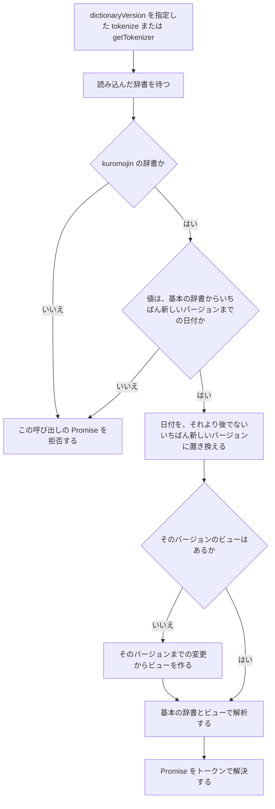
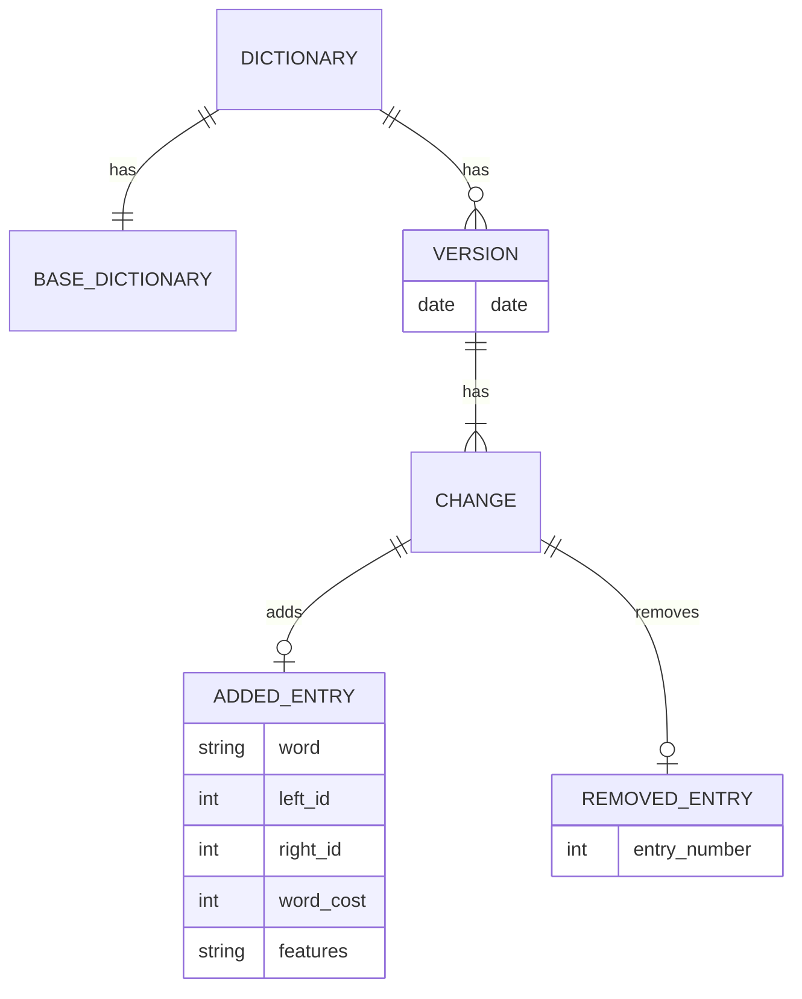

# 辞書のバージョンの設計

[English](design.md)

## この文書について

この設計は、kuromojin が [kuromojin の Product](../../product.ja.md) の [辞書のバージョンの Requirements](requirements.ja.md) をどう満たすかを説明します。

### 読者

kuromojin が辞書の変更を保存する方法、または解析がそれを使う方法を変更する人とエージェント。

### 前提知識

- [辞書のバージョンの Requirements](requirements.ja.md)
- [辞書の Requirements](../dictionary/requirements.ja.md)。辞書ファイルと、その読み込み方
- [トークン化の Requirements](../tokenization/requirements.ja.md)。トークンと、その再利用

### この文書の範囲外

基本の辞書をどう保存し読み込むか、および解析がテキストのもっともよい分け方をどう選ぶか。

## 実装の方針

基本の辞書は一度だけ読み込み、メモリの上で変更しません。
バージョンの変更は、同じ辞書ファイルの中の小さなリストです。
呼び出し元が指定したバージョンごとに、kuromojin はビューを作ります。ビューは、そのバージョンまでの変更を、解析が引ける形にしたものです。
バージョンを指定した呼び出しの解析は、基本の辞書とビューを一緒に読みます。バージョンを指定しない呼び出しの解析は、基本の辞書だけを読みます。

### 辞書ファイルの中のバージョン

辞書ファイルの先頭の表は、そのファイルのバージョンを並べます。基本の辞書の日付と、その後のすべてのバージョンの日付を、順に持ちます。
そのため kuromojin は、部分を展開しなくても、いちばん新しいバージョンを知り、呼び出し元が指定した日付を確かめられます。

変更は、ファイルの 1 つの部分で、バージョンの順に並びます。
変更は次の 2 種類のどちらかです。

- 追加するエントリー。単語、左 ID、右 ID、単語のコスト、素性を、基本の辞書と同じように持つ
- 削除するエントリー。基本の辞書のエントリー、またはより前のバージョンが追加したエントリーの番号

リストは増えるだけです。リリースは、既存の変更の後ろに、リストのどのバージョンよりも後の日付のバージョンの変更を追加し、既存の変更は修正しません。
この順序によって、リリース済みのバージョンの辞書は、後のすべてのリリースで同じになります。

### 日付からバージョンへ

kuromojin は、まず `dictionaryVersion` の値を確かめます。形、暦にある日付であること、基本の辞書より前でないこと、いちばん新しいバージョンより後でないことです。
次に、その日付を、それより後でないいちばん新しいバージョンの日付に置き換えます。
この後の処理はすべてその日付だけを使います。そのため、同じバージョンを意味する 2 つの日付は、1 つのビュー、1 つのトークナイザー、同じ覚えたトークンを共有します。

`dictionaryVersion` のない呼び出しは、メジャーバージョンの既定のバージョンを使います。これはコードの中の定数です。

### バージョンのビュー

ビューは、そのバージョンが初めて使われたときに作り、プロセスが終わるまで保持します。
ビューは、そのバージョンより後でないバージョンの変更から作り、次の 3 つを持ちます。

- 基本の辞書のうち、削除したエントリーの番号
- 追加したエントリーのうち、後で削除されていないもの。単語、ID、コスト、素性を持つ
- 単語の最初の文字から、その文字で始まる追加した単語への索引

このメジャーバージョンでは基本の辞書が既定のバージョンなので、バージョンを指定しない呼び出しにはビューがありません。
バージョンのビューは変更だけを持つので、そのメモリは変更の数に応じて増え、辞書の大きさには応じません。

### ビューを使う解析

解析は、テキストのそれぞれの位置で、そこから始まる単語を集めます。
ビューがあるときは、2 つの場所から集めます。削除したエントリーを除いた基本の辞書の単語と、その位置でテキストに一致するビューの追加した単語です。
読む順序は次のとおりです。短い単語を長い単語より先にし、1 つの単語については、基本の辞書のエントリーを追加したエントリーより先にします。追加したエントリーは、変更のリストの順です。
これは、追加したエントリーを基本の辞書のエントリーの後ろに置いて作った辞書の順序です。2 つの分け方のコストが等しいときは先の候補が選ばれるので、この順序が結果を決めます。

解析は、ある位置から始まる、エントリーを持つ単語がないときに、その位置で未知語を作ります。
ビューがあるときは、すべてのエントリーが削除された単語は数えず、追加した単語は数えます。

追加したエントリーは、基本の辞書の番号の後ろの番号を、変更のリストの順に持ちます。
`word_id` は、基本の辞書のエントリーと同じようにこの番号から計算します。そのため、後のバージョンをリストに追加しても変わりません。

追加した単語の検索は、同じ文字で始まる追加した単語を順に調べます。
これは数百の単語を変えるバージョンのための作りで、辞書の大きな部分を置き換えるバージョンのためのものではありません。

### バージョンのトークナイザー

`getTokenizer` は、バージョンの日付からトークナイザーへのマップに、バージョンごとに 1 つのトークナイザーを保持します。
バージョンのトークナイザーは、トークナイザーの 2 つの関数を持ち、どちらもそのバージョンのビューで解析します。
すべてのトークナイザーは、基本の辞書と解析のメモリを共有します。1 つの解析は、別の解析が始まる前に最後まで進むためです。

### トークンの再利用

`tokenize` は、すべてのバージョンのために、覚えたトークンのマップを 1 つ持ちます。
キーは、バージョンの日付とテキストの組です。あるバージョンのトークンを別のバージョンに返さないためです。
マップの上限は、すべてのバージョンのエントリーを合わせて数えます。

### エラー

使えない値のときは、辞書を読み込んだ後、解析の前に、その呼び出しの Promise を拒否します。
エラーはその呼び出しのために作り、保存しません。そのため、読み込んだ辞書、ほかのバージョン、後の呼び出しには影響しません。

### リポジトリの中の変更

変更は、リポジトリのテキストファイルに、1 行に 1 つ、バージョンの日付と一緒に書きます。
追加するエントリーは、IPADIC のソースファイルの形で書きます。プルリクエストをレビューする人が、単語、ID、コスト、素性をそのまま読めるようにするためです。

辞書ファイルを作るスクリプトが、このファイルを読みます。
スクリプトは、ID が品詞の間のコストにあること、削除するエントリーがあること、前のリリースが持つバージョンの変更が変わっていないことを確かめます。
その後、変更を辞書ファイルに書き、同じ行から、読む人のためのバージョンの一覧を書きます。
読む人のための一覧は、`dict` ディレクトリの辞書ファイルの隣にある Markdown ファイルです。そのため、npm パッケージで公開されます。

## アーキテクチャとシーケンス図

バージョンを指定した呼び出しは、次の手順で進みます。

## データモデルと ER 図

- **バージョン：** 日付。辞書のバージョンは、日付の順に並ぶ。
- **変更：** 追加するエントリー、または削除するエントリー。1 つのバージョンに属する。
- **ビュー：** あるバージョンまでのすべてのバージョンの変更を、メモリの上に持ったもの。1 つのビューは 1 つのバージョンに属する。

## API とインターフェース

- `getTokenizerOption.dictionaryVersion?: string` は、`tokenize` または `getTokenizer` の呼び出しの辞書のバージョンである。
- 辞書ファイルの表は、そのファイルのバージョンの日付を並べる。
- 辞書ファイルの変更の部分は、追加するエントリーと削除するエントリーを持つ。
- npm パッケージは、読む人のためのバージョンの一覧を `dict` ディレクトリで公開する。

## 外部サービスとの連携

なし。

## データの扱い

変更は辞書ファイルから読むだけで、書きません。
ビューは、プロセスが終わるまでメモリに残ります。

## 認証と認可の注意

なし。

## セキュリティの考慮事項

[Requirements のセキュリティの考慮事項](requirements.ja.md#セキュリティの考慮事項) のほかにはありません。

## デプロイの注意

バージョンを追加するリリースは、kuromojin のマイナーバージョンです。既定のバージョンとリリース済みのバージョンのトークンが変わらないためです。
既定のバージョンを変えるリリース、またはバージョンを取り除くリリースは、メジャーバージョンです。

リリース済みのバージョンの変更は編集しません。リリース済みのバージョンの誤りは、誤ったエントリーを削除して正しいエントリーを追加する、後のバージョンで直します。

## 検討した代替案

### プロセス全体で 1 つのバージョン

環境変数やグローバルの設定でプロセスのバージョンを一度だけ選び、すべての呼び出し元が 1 つの辞書を共有する方法です。
採用しませんでした。バージョンに依存するのは、トークンをパターンと比べる呼び出し元だからです。ルールを実行する書き手は、それぞれのルールがどのトークンを想定しているかを知りません。また、最初の呼び出し元が選んだバージョンを使うと、結果がルールの順序で変わります。

### バージョンごとの辞書ファイル

それぞれのバージョンを、完全な辞書ファイルにする方法です。
採用しませんでした。パッケージとダウンロードのサイズが、バージョンごとに辞書 1 つ分増え、2 つのバージョンを使うプロセスは 2 つの辞書を読み込むためです。

### バージョンごとの表をメモリの上に作る

バージョンが初めて使われたときに、基本の辞書と変更から、そのバージョンのトライと表を作る方法です。
採用しませんでした。基本の辞書との違いは少数の単語なのに、バージョンごとに辞書全体の時間とメモリがかかるためです。

### いちばん新しいバージョンより後の日付を受け付ける

いちばん新しいバージョンより後の日付を、いちばん新しいバージョンとして扱う方法です。
採用しませんでした。インストールされた kuromojin がルールの想定より古いときに、エラーを出さずに古い辞書で解析し、同じ日付のトークンが kuromojin の更新で変わるためです。

### いちばん新しいバージョンを表す名前

`latest` のような値で、インストールされた kuromojin のいちばん新しいバージョンを指す方法です。
採用しませんでした。呼び出し元のトークンが kuromojin の更新で変わるためです。バージョンは、これを防ぐためにあります。

### 日付の代わりに番号

バージョンを、増えていく番号にする方法です。
採用しませんでした。日付は、バージョンの順序と、そのバージョンがいつ作られたかを伝え、2 つのバージョンの間の日付にも意味を持たせられるためです。

### 個々の変更を有効や無効にする

日付に加えて、呼び出し元が個々の変更を選べるようにする方法です。
採用しませんでした。変更の組み合わせのそれぞれが、トークンを保たなければならない 1 つの辞書になるためです。また、呼び出し元には、あるバージョンの 1 つの単語だけを拒む理由がありません。

## 未解決事項

- **変更の多いバージョン：** 追加した単語の検索は、同じ文字で始まる追加した単語を順に調べるので、テキストによく出る数千の単語をバージョンが変えると遅くなる。決めるまでは、1 つのバージョンが変える単語は多くても数百とする。より多くの変更を持つバージョンが提案されたとき、またはバージョンを指定した解析が、指定しない解析より測定できるほど遅いときに見直す。azu が決める。
