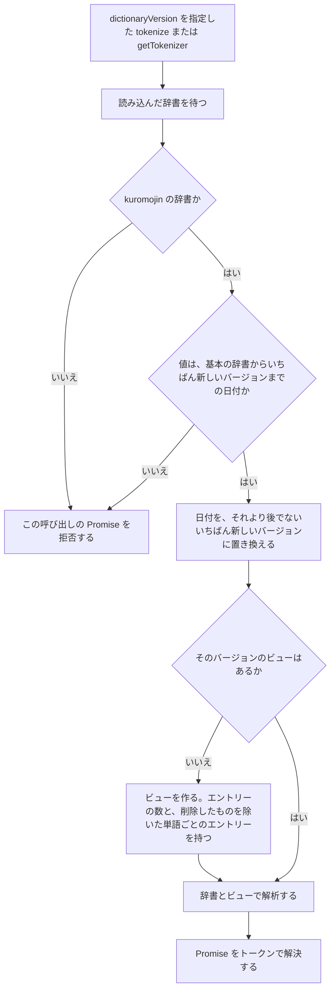
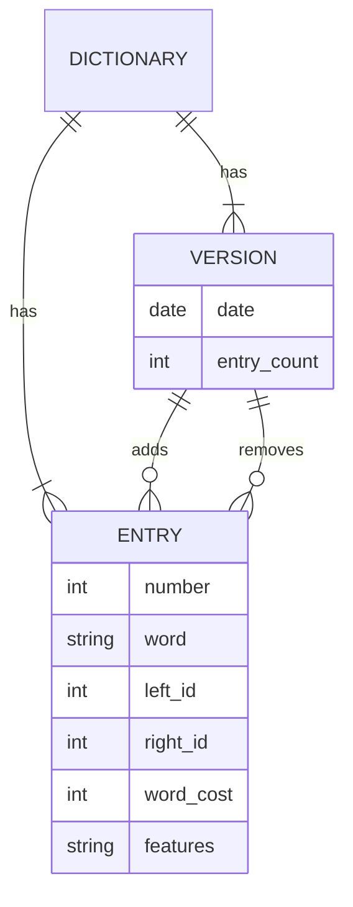

# 辞書のバージョンの設計

[English](design.md)

## この文書について

この設計は、kuromojin が [kuromojin の Product](../../product.ja.md) の [辞書のバージョンの Requirements](requirements.ja.md) をどう満たすかを説明します。

### 読者

kuromojin が辞書のバージョンを保存する方法、または解析がそれを使う方法を変更する人とエージェント。

### 前提知識

- [辞書のバージョンの Requirements](requirements.ja.md)
- [辞書の Requirements](../dictionary/requirements.ja.md)。辞書ファイルと、その読み込み方
- [トークン化の Requirements](../tokenization/requirements.ja.md)。トークンと、その再利用

### この文書の範囲外

基本の辞書をどう保存し読み込むか、および解析がテキストのもっともよい分け方をどう選ぶか。

## 実装の方針

辞書ファイルは、すべてのバージョンのエントリーを同じ部分に持ちます。辞書は一度だけ読み込み、メモリの上で変更しません。
バージョンが追加するエントリーは、基本の辞書のエントリーの後ろの番号を、バージョンの順に持ちます。
そのため、あるバージョンの辞書は、ある番号より前のエントリーから、そのバージョンまでに削除したエントリーを除いたものです。
どの呼び出しの解析も同じ部分を読み、その呼び出しのバージョンに見えないエントリーを読み飛ばします。
バージョンを指定した呼び出しと指定しない呼び出しは、同じ経路を通ります。

### 辞書ファイルの中のバージョン

辞書ファイルの各部分は、基本の辞書とすべてのバージョンの単語とエントリーを、まとめて持ちます。単語の 1 つのトライ、単語ごとのエントリーの 1 つのリスト、それぞれのエントリーの ID とコストと素性です。
エントリーは番号を持ちます。基本の辞書のエントリーが最初の番号を持ち、バージョンが追加するエントリーが、バージョンの順にその後ろに続きます。
単語のエントリーのリストでは、追加したエントリーは、その単語がすでに持つエントリーの後ろに並びます。

辞書ファイルの先頭の表は、バージョンを日付の順に並べます。最初のバージョンは基本の辞書です。
表は、バージョンごとに次の 4 つを持ちます。

- 日付
- そのバージョンまでの辞書のエントリーの数
- そのバージョンが削除するエントリーの番号。基本の辞書のエントリー、またはより前のバージョンが追加したエントリーである
- そのバージョンの変更のダイジェスト。辞書ファイルを作るスクリプトが使う

そのため kuromojin は、部分を展開しなくても、いちばん新しいバージョンを知り、呼び出し元が指定した日付を確かめられます。

バージョンは増えるだけです。リリースは、ファイルのどのバージョンよりも後の日付のバージョンを追加し、そのエントリーは既存のすべてのエントリーの後ろの番号を持ちます。既存のバージョンは修正しません。
そのため、エントリーの番号と、リリース済みのバージョンの辞書は、後のすべてのリリースで同じになります。

### 日付からバージョンへ

kuromojin は、まず `dictionaryVersion` の値を確かめます。形、暦にある日付であること、基本の辞書より前でないこと、いちばん新しいバージョンより後でないことです。
次に、その日付を、それより後でないいちばん新しいバージョンの日付に置き換えます。
この後の処理はすべてその日付だけを使います。そのため、同じバージョンを意味する 2 つの日付は、1 つのビュー、1 つのトークナイザー、同じ覚えたトークンを共有します。

`dictionaryVersion` のない呼び出しは、メジャーバージョンの既定のバージョンを使います。これはコードの中の定数です。

### バージョンのビュー

ビューは、あるバージョンにどのエントリーが見えるかを、解析に伝えます。ビューは次の 2 つを持ちます。

- **エントリーの数：** そのバージョンまでの辞書のエントリーの数。この数以上の番号のエントリーは、後のバージョンのものである。
- **単語ごとのエントリー：** 単語ごとのエントリーのリスト。そのバージョンまでに削除したエントリーがないビューは、辞書のリストをそのまま使う。それ以外のビューは、リストの自分用のコピーを持ち、その中で、削除したエントリーを、どのエントリーの番号よりも大きい数に置き換える。

ビューは、そのバージョンが初めて使われたときに作り、プロセスが終わるまで保持します。
バージョンを指定しない呼び出しは、既定のバージョンのビューを使います。このメジャーバージョンでは、基本の辞書が既定のバージョンです。

### ビューを使う解析

解析は、テキストのそれぞれの位置で、そこから始まるトライの単語を集めます。単語ごとに、ビューのリストからエントリーを読みます。
番号がビューのエントリーの数より小さくないエントリーは、読み飛ばします。
この 1 回の比較が、後のバージョンのエントリーと削除したエントリーの両方を扱います。削除したエントリーは、ビューのリストの中で、どのエントリーの番号よりも大きい数になっているためです。
どの呼び出しも同じ比較をするので、解析の経路は 1 つで、バージョンのエントリーは基本の辞書のエントリーと同じように処理します。
バージョンが解析にかけるコストは、そのエントリーの候補の分です。これは、それらのエントリーを入れて作った辞書と同じです。

解析は、短い単語を長い単語より先に読み、1 つの単語のエントリーをリストの順に読みます。
2 つの分け方のコストが等しいときは先の候補が選ばれるので、この順序が結果を決めます。
バージョンは、エントリーを削除して新しいエントリーを追加することで、エントリーを変更します。そのため、変更したエントリーは、その単語の最後のエントリーになります。

解析は、ある位置から始まる、ビューに見えるエントリーを持つ単語がないときに、その位置で未知語を作ります。
そのため、すべてのエントリーが削除されているか後のバージョンのものである単語は、数えません。

`word_id` はエントリーの番号から計算するので、後のバージョンを追加しても変わりません。

### バージョンのトークナイザー

`getTokenizer` は、バージョンの日付からトークナイザーへのマップに、バージョンごとに 1 つのトークナイザーを保持します。
バージョンのトークナイザーは、トークナイザーの 2 つの関数を持ち、どちらもそのバージョンのビューで解析します。
すべてのトークナイザーは、読み込んだ辞書と解析のメモリを共有します。1 つの解析は、別の解析が始まる前に最後まで進むためです。

### トークンの再利用

`tokenize` は、すべてのバージョンのために、覚えたトークンのマップを 1 つ持ちます。
キーは、バージョンの日付とテキストの組です。あるバージョンのトークンを別のバージョンに返さないためです。
マップの上限は、すべてのバージョンのエントリーを合わせて数えます。

### エラー

使えない値のときは、辞書を読み込んだ後、解析の前に、その呼び出しの Promise を拒否します。
エラーはその呼び出しのために作り、保存しません。そのため、読み込んだ辞書、ほかのバージョン、後の呼び出しには影響しません。

### リポジトリの中の変更

変更は、リポジトリのテキストファイルに、1 行に 1 つ、バージョンの日付と一緒に書きます。
追加するエントリーは、IPADIC のソースファイルの形で書きます。プルリクエストをレビューする人が、単語、ID、コスト、素性をそのまま読めるようにするためです。

辞書ファイルを作るスクリプトが、このファイルを読みます。
スクリプトは、ID が品詞の間のコストにあることと、削除するエントリーがあることを確かめます。
それぞれのバージョンのダイジェストを、既存の辞書ファイルのダイジェストと比べ、そのファイルのバージョンが変わっているかなくなっているときは、止まります。
その後、すべてのバージョンのエントリーを入れた辞書ファイルを作り、同じ行から、読む人のためのバージョンの一覧を書きます。
読む人のための一覧は、`dict` ディレクトリの辞書ファイルの隣にある Markdown ファイルです。そのため、npm パッケージで公開されます。

## アーキテクチャとシーケンス図

バージョンを指定した呼び出しは、次の手順で進みます。

## データモデルと ER 図

- **バージョン：** 日付と、そのバージョンまでの辞書のエントリーの数。辞書のバージョンは日付の順に並び、最初のバージョンは基本の辞書である。
- **エントリー：** 単語と、その ID、コスト、素性。1 つのバージョンが追加し、後のバージョンが削除できる。
- **ビュー：** あるバージョンに見えるエントリーを、メモリの上に持ったもの。1 つのビューは 1 つのバージョンに属する。

## API とインターフェース

- `getTokenizerOption.dictionaryVersion?: DictionaryVersion` は、`tokenize` または `getTokenizer` の呼び出しの辞書のバージョンである。
- `DictionaryVersion` は、`YYYY-MM-DD` で書いた日付の型である。3 つの数を `-` でつないだ文字列を表す。型が確かめるのはこの形だけで、残りは呼び出しが確かめる。
- 辞書ファイルの表は、バージョンを並べる。バージョンごとに、日付、エントリーの数、削除するエントリーの番号、変更のダイジェストを持つ。
- npm パッケージは、読む人のためのバージョンの一覧を `dict` ディレクトリで公開する。

## 外部サービスとの連携

なし。

## データの扱い

辞書とそのバージョンは、辞書ファイルから読むだけで、書きません。
ビューは、プロセスが終わるまでメモリに残ります。
削除したエントリーのあるビューは、単語ごとのエントリーの自分用のコピーを持ちます。それ以外のビューは、自分用のデータを持ちません。

## 認証と認可の注意

なし。

## セキュリティの考慮事項

[Requirements のセキュリティの考慮事項](requirements.ja.md#セキュリティの考慮事項) のほかにはありません。

## デプロイの注意

バージョンを追加するリリースは、kuromojin のマイナーバージョンです。既定のバージョンとリリース済みのバージョンのトークンが変わらないためです。
既定のバージョンを変えるリリース、またはバージョンを取り除くリリースは、メジャーバージョンです。

リリース済みのバージョンの変更は編集しません。リリース済みのバージョンの誤りは、誤ったエントリーを削除して正しいエントリーを追加する、後のバージョンで直します。

すべてのバージョンのエントリーが辞書ファイルにあります。そのため、バージョンは、それを指定しない呼び出し元にとっても、パッケージのサイズを増やします。

## 検討した代替案

### プロセス全体で 1 つのバージョン

環境変数やグローバルの設定でプロセスのバージョンを一度だけ選び、すべての呼び出し元が 1 つの辞書を共有する方法です。
採用しませんでした。バージョンに依存するのは、トークンをパターンと比べる呼び出し元だからです。ルールを実行する書き手は、それぞれのルールがどのトークンを想定しているかを知りません。また、最初の呼び出し元が選んだバージョンを使うと、結果がルールの順序で変わります。

### バージョンごとの辞書ファイル

それぞれのバージョンを、完全な辞書ファイルにする方法です。
採用しませんでした。パッケージとダウンロードのサイズが、バージョンごとに辞書 1 つ分増え、2 つのバージョンを使うプロセスは 2 つの辞書を読み込むためです。

### バージョンごとの辞書をメモリの上に作る

バージョンが初めて使われたときに、そのバージョンのエントリーだけを持つトライと表を作る方法です。解析は比較をしなくて済みます。
採用しませんでした。バージョンは呼び出しごとに選び、1 つのプロセスが複数のバージョンを使えるためです。バージョンは、ほかのバージョンと少しの単語しか違わないのに、それぞれが辞書全体の時間とメモリを使います。

### 変更を辞書と分けて持つ

辞書ファイルが基本の辞書と変更のリストを別に持ち、ビューがそのバージョンの追加したエントリーと専用のトライを持つ方法です。
採用しませんでした。バージョンを指定した解析が、候補を 2 つの場所から集め、バージョンを指定しない呼び出しが通らない経路を通るためです。バージョンを指定した解析は、追加した単語を含まないテキストでも、すべて遅くなります。

### いちばん新しいバージョンより後の日付を受け付ける

いちばん新しいバージョンより後の日付を、いちばん新しいバージョンとして扱う方法です。
採用しませんでした。インストールされた kuromojin がルールの想定より古いときに、エラーを出さずに古い辞書で解析し、同じ日付のトークンが kuromojin の更新で変わるためです。

### いちばん新しいバージョンを表す名前

`latest` のような値で、インストールされた kuromojin のいちばん新しいバージョンを指す方法です。
採用しませんでした。呼び出し元のトークンが kuromojin の更新で変わるためです。バージョンは、これを防ぐためにあります。

### 日付の代わりに番号

バージョンを、増えていく番号にする方法です。
採用しませんでした。日付は、バージョンの順序と、そのバージョンがいつ作られたかを伝え、2 つのバージョンの間の日付にも意味を持たせられるためです。

### 個々の変更を有効や無効にする

日付に加えて、呼び出し元が個々の変更を選べるようにする方法です。
採用しませんでした。変更の組み合わせのそれぞれが、トークンを保たなければならない 1 つの辞書になるためです。また、呼び出し元には、あるバージョンの 1 つの単語だけを拒む理由がありません。

## 未解決事項

なし。
