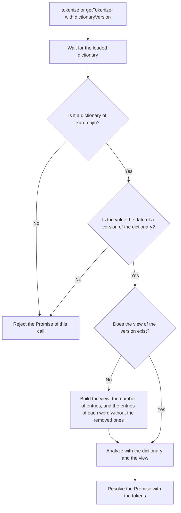
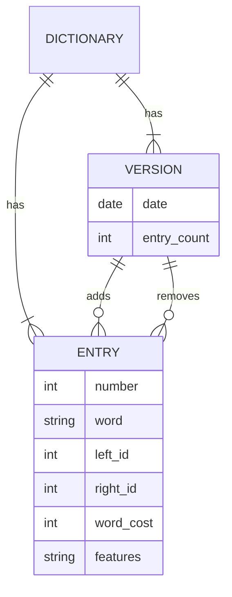

# Dictionary versions design

[日本語](design.ja.md)

## About this document

This design explains how kuromojin meets the [Dictionary versions Requirements](requirements.md) of the [kuromojin Product](../../product.md).

### Audience

People and agents who change how kuromojin stores the dictionary versions, or how the analysis uses them.

### Prerequisites

- The [Dictionary versions Requirements](requirements.md)
- The [Dictionary Requirements](../dictionary/requirements.md), for the dictionary file and how it is loaded
- The [Tokenization Requirements](../tokenization/requirements.md), for the tokens and their reuse

### Outside this document

How the base dictionary is stored and loaded, and how the analysis chooses the best split of a text.

## Implementation approach

The dictionary file holds the entries of all its versions in the same parts. It is loaded once and never changed in memory.
The entries that versions add have the numbers after the entries of the base dictionary, in the order of the versions.
So the dictionary of a version is the entries below one number, without the entries that the versions up to it remove.
The analysis of every call reads the same parts and passes over the entries that the version of the call does not see.
A call with a version and a call without one take the same path.

### Versions in the dictionary file

The parts of the dictionary file hold the words and the entries of the base dictionary and of every version together: one trie of words, one list of entries for each word, and the ids, the cost, and the features of each entry.
An entry has a number. The entries of the base dictionary have the first numbers, and the entries that a version adds follow in the order of the versions.
In the list of entries of a word, an added entry comes after the entries that the word already has.

The table at the start of the dictionary file lists the versions in the order of their dates, and the first one is the base dictionary.
For each version, the table has four things.

- The date
- The number of entries of the dictionary up to the version
- The numbers of the entries that the version removes: entries of the base dictionary, or entries that an earlier version added
- A digest of the changes of the version, for the script that builds the dictionary file

So kuromojin knows the newest version, and can check a date that a caller names, without decompressing a part.

The versions only grow. A release adds versions whose dates are later than every version of the file, and their entries get the numbers after all existing entries. It does not alter the existing versions.
So the number of an entry, and with it the dictionary of a released version, is the same in every later release.

### Version of a call

kuromojin looks the value of `dictionaryVersion` up in the set of the dates of the versions, which it makes when the dictionary is loaded.
A value in the set is the version of the call. This step compares no dates.
A value that is not in the set is an error, and only then kuromojin looks at the value to tell the reason: its form, and whether it is later than the newest version.

A call without `dictionaryVersion` uses the default version of the major version, which is a constant in the code.

### View of a version

A view tells the analysis which entries a version sees. It has two things.

- **Number of entries:** The number of entries of the dictionary up to the version. An entry with this number or a larger one belongs to a later version.
- **Entries of each word:** The list of entries of each word. A view of a version up to which no entry is removed uses the list of the dictionary itself. Any other view has its own copy of the list, in which each removed entry is replaced by a number that is larger than the number of every entry.

A view is built when its version is used for the first time, and it is kept until the process ends.
A call without a version uses the view of the default version. The base dictionary is the default version in this major version.

### Analysis with a view

At each position of the text, the analysis collects the words of the trie that start there. For each word, it reads the entries from the list of the view.
It passes over an entry whose number is not below the number of entries of the view.
This one comparison covers the entries of later versions and the removed entries, because a removed entry has a number that is larger than the number of every entry in the list of the view.
Every call runs the same comparison, so the analysis has one path, and the entries of a version are handled as the entries of the base dictionary are.
What a version costs in an analysis is the candidates of its entries, as in a dictionary that was built with those entries.

The analysis reads shorter words before longer words, and the entries of one word in the order of its list.
The order matters, because the first candidate wins when two splits have the same cost.
A version changes an entry by removing it and adding the new one, so a changed entry becomes the last entry of its word.

The analysis makes an unknown word at a position when no word with an entry that the view sees starts there.
So a word does not count when all its entries are removed or belong to later versions.

`word_id` is computed from the number of the entry, so it does not change when later versions are added.

### Tokenizer of a version

`getTokenizer` keeps one tokenizer for each version in a map from the date of the version to the tokenizer.
The tokenizer of a version has the two functions of a tokenizer, and they analyze with the view of that version.
All tokenizers share the loaded dictionary and the memory of the analysis, because an analysis runs to its end before another one starts.

### Reuse of tokens

`tokenize` keeps one map of remembered tokens for all versions.
The key is the text. Its value has the tokens of each version together with the date of the version, so that the tokens of one version are never returned for another one.
The limit of the map counts texts, so a text that is analyzed with several versions is one entry.

### Errors

A value that cannot be used rejects the Promise of that call, after the dictionary is loaded and before any analysis.
The error is made for the call and is not stored, so it does not affect the loaded dictionary, the other versions, or later calls.

### Changes in the repository

The changes are written in a text file of the repository, one change per line, with the date of its version.
An added entry is written in the form of the IPADIC source files, so that a reviewer of a pull request reads the word, its ids, its cost, and its features as they are.

The script that builds the dictionary file reads this file.
It checks that the ids exist in the costs between parts of speech and that a removed entry exists.
It compares the digest of each version with the digest in the existing dictionary file, and it stops when a version of that file is changed or missing.
It then builds the dictionary file with the entries of all versions, and it writes the list of versions for readers and the type `DictionaryVersion` from the same lines.
The list for readers is a Markdown file in the `dict` directory, next to the dictionary file, so it is published with the npm package.

## Architecture and sequence diagrams

A call with a version goes through these steps.

## Data model and ER diagrams

- **Version:** A date and the number of entries of the dictionary up to it. The versions of a dictionary are in the order of their dates, and the first one is the base dictionary.
- **Entry:** A word with its ids, cost, and features. One version adds it, and a later version can remove it.
- **View:** The entries that one version sees, in memory. One view belongs to one version.

## APIs and interfaces

- `getTokenizerOption.dictionaryVersion?: DictionaryVersion` is the dictionary version of a call of `tokenize` or `getTokenizer`.
- `DictionaryVersion` is the type of the value: the union of the dates of the versions of the dictionary of the package. A call still checks the value, because a caller without types can pass any value and a dictionary from a dictionary path can have other versions.
- The table of the dictionary file lists the versions: for each one, its date, its number of entries, the numbers of the entries that it removes, and the digest of its changes.
- The npm package publishes the list of versions for readers in the `dict` directory.

## External service integration

None.

## Data handling

The dictionary and its versions are read from the dictionary file and never written.
The views stay in memory until the process ends.
A view with removed entries holds its copy of the entries of each word. Any other view holds no data of its own.

## Authentication and authorization notes

None.

## Security considerations

None beyond the [security considerations of the Requirements](requirements.md#security-considerations).

## Deployment notes

A release that adds a version is a minor version of kuromojin, because the default version and the released versions keep their tokens.
A release that changes the default version, or removes a version, is a major version.

The changes of a released version are not edited. A mistake in a released version is corrected by a later version that removes the wrong entry and adds the right one.

The entries of every version are in the dictionary file, so a version adds to the size of the package also for callers that do not name it.

## Alternatives considered

### One version for the whole process

The version could be chosen once for a process, by an environment variable or a global setting, and all callers would share one dictionary.
It was not chosen, because the caller that compares tokens with patterns is the one that depends on the version. A writer who runs the rules does not know which tokens each rule expects, and a version chosen by the first caller would make the result depend on the order of the rules.

### A dictionary file for each version

Each version could be a complete dictionary file.
It was not chosen, because the size of the package and of a download would grow by a whole dictionary for each version, and a process with two versions would load two dictionaries.

### A dictionary in memory for each version

kuromojin could build the trie and the tables of a version when the version is first used, with only the entries of that version. The analysis would then need no comparison.
It was not chosen, because the version is chosen for each call, and a process can use several versions. Each version would cost the time and the memory of a whole dictionary, although it differs from the others in a few words.

### Keep the changes apart from the dictionary

The dictionary file could hold the base dictionary and a separate list of changes, and a view could hold the added entries of its version with a trie of their own.
It was not chosen, because the analysis with a version would collect its candidates from two places, on a path that a call without a version does not take. Every analysis with a version would be slower, also for a text without any added word.

### Accept a date later than the newest version

A date later than the newest version could mean the newest version.
It was not chosen, because an installed kuromojin that is older than the rule expects would then analyze with an older dictionary without any error, and the tokens of the same date would change when kuromojin is updated.

### Accept a date between two versions

A date between the dates of two versions could mean the earlier one, so that a caller could write the date on which its code was written.
It was not chosen, because a date with a mistake would then analyze with another dictionary than the caller expects, without any error.
The type of the option has the dates of the versions, so a caller sees the versions where it writes the date.
A call also needs no check of the calendar and no search for the version then.

### A name for the newest version

A value such as `latest` could mean the newest version of the installed kuromojin.
It was not chosen, because the tokens of the caller would change with an update of kuromojin, which is what a version is there to prevent.

### Numbers instead of dates

A version could be a number that counts up.
It was not chosen, because a date tells the order of the versions and when a version was made.

### Turn single changes on and off

A caller could choose single changes in addition to a date.
It was not chosen, because every combination of changes would be a dictionary of its own that has to keep its tokens, and a caller has no reason to refuse one word of a version.

## Open questions

None.
