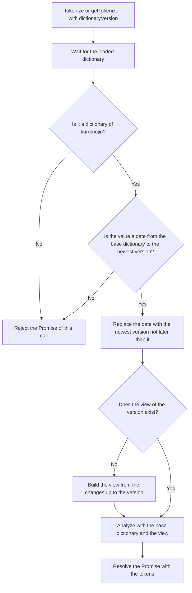
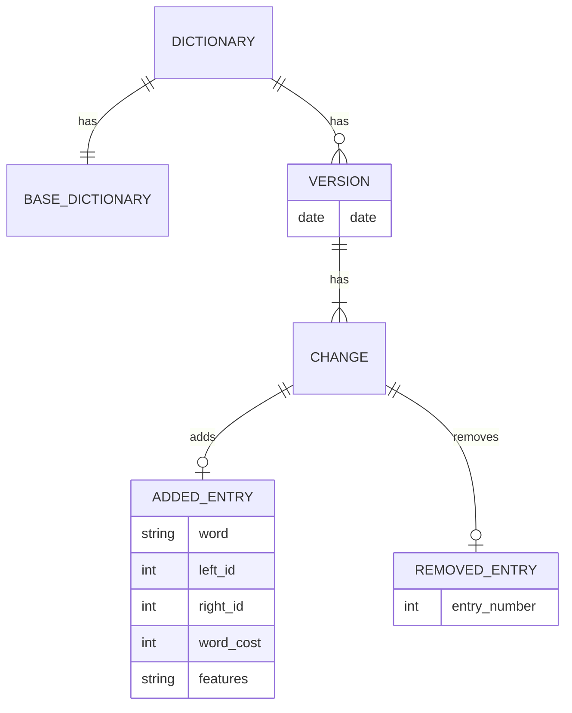

# Dictionary versions design

[日本語](design.ja.md)

## About this document

This design explains how kuromojin meets the [Dictionary versions Requirements](requirements.md) of the [kuromojin Product](../../product.md).

### Audience

People and agents who change how kuromojin stores the changes of the dictionary, or how the analysis uses them.

### Prerequisites

- The [Dictionary versions Requirements](requirements.md)
- The [Dictionary Requirements](../dictionary/requirements.md), for the dictionary file and how it is loaded
- The [Tokenization Requirements](../tokenization/requirements.md), for the tokens and their reuse

### Outside this document

How the base dictionary is stored and loaded, and how the analysis chooses the best split of a text.

## Implementation approach

The base dictionary is loaded once and never changed in memory.
The changes of the versions are a small list in the same dictionary file.
For each version that a caller names, kuromojin builds a view: the changes up to that version, in a form that the analysis can look up.
The analysis of a call with a version reads the base dictionary and the view together. The analysis of a call without a version reads the base dictionary only.

### Versions in the dictionary file

The table at the start of the dictionary file lists the versions of the file: the date of the base dictionary, and the date of every later version in order.
So kuromojin knows the newest version, and can check a date that a caller names, without decompressing a part.

The changes are one part of the file, in the order of their versions.
A change is one of two kinds.

- An added entry: the word, its left id, its right id, its word cost, and its features, as in the base dictionary
- A removed entry: the number of an entry of the base dictionary, or of an entry that an earlier version added

The list only grows. A release adds changes after the existing ones, with a version whose date is later than every version of the list, and it does not alter the existing ones.
This order is what makes the dictionary of a released version the same in every later release.

### From a date to a version

kuromojin first checks the value of `dictionaryVersion`: its form, that it is a date of the calendar, and that it is not earlier than the base dictionary and not later than the newest version.
Then it replaces the date with the date of the newest version that is not later than it.
Everything after this step uses that date only, so two dates that mean the same version share one view, one tokenizer, and the same remembered tokens.

A call without `dictionaryVersion` uses the default version of the major version, which is a constant in the code.

### View of a version

A view is built when its version is used for the first time, and it is kept until the process ends.
It is built from the changes whose version is not later than the version of the view, and it has three things.

- The numbers of the removed entries of the base dictionary
- The added entries that are not removed again: their words, ids, costs, and features
- An index from the first character of a word to the added words that start with it

The base dictionary is the default version in this major version, so a call without a version has no view.
The view of a version holds only its changes, so its memory grows with the number of changes and not with the size of the dictionary.

### Analysis with a view

At each position of the text, the analysis collects the words that start there.
With a view, it collects them from two places: the words of the base dictionary, without the removed entries, and the added words of the view that match the text at that position.
It reads them in this order: shorter words before longer words, and for one word, the entries of the base dictionary before the added entries, which are in the order of the list of changes.
This is the order of a dictionary that was built with the added entries after the entries of the base dictionary. The order matters, because the first candidate wins when two splits have the same cost.

The analysis makes an unknown word at a position when no word with an entry starts there.
With a view, a word whose entries are all removed does not count, and an added word counts.

An added entry has a number after the numbers of the base dictionary, in the order of the list of changes.
`word_id` is computed from the number as for the entries of the base dictionary, so it does not change when later versions are added to the list.

The search of added words is a scan of the added words that start with the same character.
It is made for versions that change hundreds of words, and not for a version that replaces a large part of the dictionary.

### Tokenizer of a version

`getTokenizer` keeps one tokenizer for each version in a map from the date of the version to the tokenizer.
The tokenizer of a version has the two functions of a tokenizer, and they analyze with the view of that version.
All tokenizers share the base dictionary and the memory of the analysis, because an analysis runs to its end before another one starts.

### Reuse of tokens

`tokenize` keeps one map of remembered tokens for all versions.
The key is the date of the version and the text together, so that the tokens of one version are never returned for another one.
The limit of the map counts the entries of all versions together.

### Errors

A value that cannot be used rejects the Promise of that call, after the dictionary is loaded and before any analysis.
The error is made for the call and is not stored, so it does not affect the loaded dictionary, the other versions, or later calls.

### Changes in the repository

The changes are written in a text file of the repository, one change per line, with the date of its version.
An added entry is written in the form of the IPADIC source files, so that a reviewer of a pull request reads the word, its ids, its cost, and its features as they are.

The script that builds the dictionary file reads this file.
It checks that the ids exist in the costs between parts of speech, that a removed entry exists, and that the changes of the versions of the last release are unchanged.
It then writes the changes into the dictionary file, and it writes the list of versions for readers from the same lines.
The list for readers is a Markdown file in the `dict` directory, next to the dictionary file, so it is published with the npm package.

## Architecture and sequence diagrams

A call with a version goes through these steps.

## Data model and ER diagrams

- **Version:** A date. The versions of a dictionary are in the order of their dates.
- **Change:** An added entry or a removed entry. It belongs to one version.
- **View:** The changes of all versions up to one version, in memory. One view belongs to one version.

## APIs and interfaces

- `getTokenizerOption.dictionaryVersion?: string` is the dictionary version of a call of `tokenize` or `getTokenizer`.
- The table of the dictionary file lists the dates of its versions.
- The part of the dictionary file with the changes holds the added and removed entries.
- The npm package publishes the list of versions for readers in the `dict` directory.

## External service integration

None.

## Data handling

The changes are read from the dictionary file and never written.
The views stay in memory until the process ends.

## Authentication and authorization notes

None.

## Security considerations

None beyond the [security considerations of the Requirements](requirements.md#security-considerations).

## Deployment notes

A release that adds a version is a minor version of kuromojin, because the default version and the released versions keep their tokens.
A release that changes the default version, or removes a version, is a major version.

The changes of a released version are not edited. A mistake in a released version is corrected by a later version that removes the wrong entry and adds the right one.

## Alternatives considered

### One version for the whole process

The version could be chosen once for a process, by an environment variable or a global setting, and all callers would share one dictionary.
It was not chosen, because the caller that compares tokens with patterns is the one that depends on the version. A writer who runs the rules does not know which tokens each rule expects, and a version chosen by the first caller would make the result depend on the order of the rules.

### A dictionary file for each version

Each version could be a complete dictionary file.
It was not chosen, because the size of the package and of a download would grow by a whole dictionary for each version, and a process with two versions would load two dictionaries.

### Build the tables of each version in memory

kuromojin could build the trie and the tables of a version from the base dictionary and the changes when the version is first used.
It was not chosen, because a version would cost the time and the memory of a whole dictionary, although it differs from the base dictionary in a few words.

### Accept a date later than the newest version

A date later than the newest version could mean the newest version.
It was not chosen, because an installed kuromojin that is older than the rule expects would then analyze with an older dictionary without any error, and the tokens of the same date would change when kuromojin is updated.

### A name for the newest version

A value such as `latest` could mean the newest version of the installed kuromojin.
It was not chosen, because the tokens of the caller would change with an update of kuromojin, which is what a version is there to prevent.

### Numbers instead of dates

A version could be a number that counts up.
It was not chosen, because a date tells the order of the versions and when a version was made, and it lets a date between two versions have a meaning.

### Turn single changes on and off

A caller could choose single changes in addition to a date.
It was not chosen, because every combination of changes would be a dictionary of its own that has to keep its tokens, and a caller has no reason to refuse one word of a version.

## Open questions

- **Versions with many changes:** The search of added words scans the added words that start with the same character, which gets slow when a version changes thousands of words that are common in texts. Until this is decided, a version changes hundreds of words at most. Revisit when a version with more changes is proposed, or when the analysis with a version is measurably slower than without one. azu decides.
