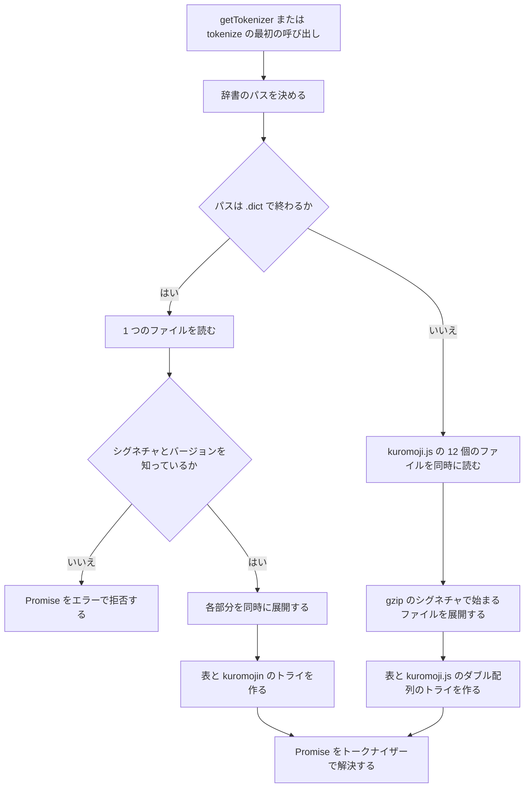

# 辞書の設計

[English](design.md)

## この文書について

この設計は、kuromojin が [kuromojin の Product](../../product.ja.md) の [辞書の Requirements](requirements.ja.md) をどう満たすかを説明します。

### 読者

kuromojin が辞書を見つける方法、読み込む方法、保存する方法を変更する人とエージェント。

### 前提知識

- [辞書の Requirements](requirements.ja.md)
- [トークン化の Requirements](../tokenization/requirements.ja.md)。辞書が保たなければならない基準の結果

### この文書の範囲外

トークナイザーが読み込んだ辞書でテキストをどう解析するか、およびトークンをどう再利用するか。

## 実装の方針

kuromojin は辞書を自分で読み込みます。
辞書のパスを決め、そこから辞書を読み、トークナイザーが読む表に変換し、トークナイザーをモジュールに保持します。
パッケージの辞書は、kuromojin の形式の 1 つのファイルです。この形式の目的は、kuromoji.js の辞書と同じ単語とコストのまま、ダウンロードを小さく、読み込みを速くすることです。

### 辞書のパス

パスは、呼び出しのたびではなく、読み込みを始めるときにだけ決めます。
kuromojin は、最初の呼び出しの `options` の `dicPath`、`KUROMOJIN_DIC_PATH`、`globalThis.kuromojin.dicPath` の順に見ます。
グローバルの設定は `globalThis` から読みます。ワーカーと Node.js には `window` がなく、ページでは `globalThis` が `window` であるためです。
どれも設定されていなければ、パッケージの `dict` ディレクトリにある `kuromojin.dict` ファイルを使います。
この既定のパスは、小さなモジュールが返します。
Node.js では、このモジュールは自分のコードの場所からファイルを見つけます。
ブラウザ向けには、`package.json` の `browser` フィールドが、このモジュールを `new URL("../dict/kuromojin.dict", import.meta.url)` だけを持つ ES モジュールに置き換えます。
この式に対応したバンドラーは、ファイルをビルドにコピーし、式をコピーの URL に置き換えます。
パッケージのほかの部分は CommonJS のままなので、kuromojin を require するルールも置き換えたモジュールを使います。
バンドラーが `import.meta` に対応していないときのように、式にベースの URL がないとき、このモジュールはパスを返さず、読み込みは辞書のパスがないエラーで失敗します。

### 一度だけの読み込み

モジュールは 2 つの値を保持します。読み込んだ辞書とそのトークナイザー、および読み込みの結果のための 1 つの Promise です。
`getTokenizer` は、読み込んだ辞書があれば、そのトークナイザーを返します。
なければ、Promise があるときはその Promise を返します。
どちらもなければ、読み込みを始め、その Promise を保持し、Promise を返します。
読み込みは、トークナイザーで Promise を解決するか、エラーで Promise を拒否します。

Promise は置き換えません。
そのため、読み込みが失敗すると拒否された Promise が残り、その後の呼び出しはすべてそれを受け取ります。

### 読み込みと展開

Node.js とブラウザの違いは、2 つの関数が隠します。
1 つ目は、ファイルのパスまたは URL を受け取り、そのバイト列を返します。Node.js ではファイルシステムでファイルを読み、ブラウザでは `fetch` で要求します。
2 つ目は、gzip のデータを展開します。Node.js では `zlib` モジュールを使い、ブラウザでは `DecompressionStream` を使います。
kuromojin は、読み込みを始めるときに、Node.js で動いているかどうかでこの組を選びます。

### 辞書の形式

辞書のパスの終わりが形式を示します。そのため、読み込みは 1 つの形式のファイルだけを読み、もう一方を試すことはありません。
`.dict` で終わるパスは、kuromojin の形式の辞書のファイルです。
それ以外のパスは、kuromoji.js の 12 個のファイルを持つディレクトリまたは URL で、12 個を同時に要求します。
サーバーは、ブラウザが `.gz` ファイルを受け取る前に gzip の圧縮を外すことがあります。そのため、12 個のファイルはそれぞれ、バイト列が gzip のシグネチャで始まるときだけ展開します。

どちらの形式も同じ表に変換するので、トークナイザーはどちらを読み込んだかを知りません。
実装が 2 つあるのは、ある位置から始まる単語の問い合わせだけです。kuromojin の形式には kuromojin のトライを使い、もう一方には kuromoji.js のダブル配列のトライを使います。

### kuromojin の形式のファイル

辞書は 1 つのファイルです。全体をまとめてコピーし、キャッシュし、要求できるようにするためで、部分どうしが違うバージョンになることもありません。
ファイルは、次の順に 3 つの領域を持ちます。

1. 固定長の先頭。このファイルが kuromojin の辞書であることを示すシグネチャ、形式のバージョン、表の長さを持つ。
2. JSON で書いた表。データの各部分の名前と、ファイルの中での位置、ファイルの中での長さ、展開後の長さを示す。そのファイルの辞書のバージョンも並べ、それぞれのバージョンまでのエントリーの数と、そのバージョンが削除するエントリーの番号を持つ。
3. データの各部分。それぞれを独立した gzip ストリームとして圧縮する。

先頭と表は圧縮しないので、kuromojin は何かを展開する前にシグネチャとバージョンを確かめます。
表は各部分より前にあります。そのため、読み込む側は、ファイルの終わりを待たずに、各部分のバイトが届いたときからその部分を展開できます。
シグネチャのないファイルや、コードが知らないバージョンのファイルのときは、読み込みをエラーで終えます。

各部分を独立した gzip ストリームにするのは、部分を同時に展開するためです。
Node.js では、`zlib` がワーカースレッドで展開し、展開後の長さがわかるので、各部分をちょうどの大きさの 1 つのバッファーに書けます。
ブラウザでは、各部分をそれぞれの `DecompressionStream` に通します。

### kuromojin の形式のデータ

各部分は、kuromoji.js の辞書と同じデータを保存します。gzip がよく圧縮でき、読み込みが配列を数回たどるだけで済むように並べます。

- **単語：** 単語の UTF-16 コード単位のトライ。ノードは幅優先の順に書き、それぞれが文字、子の数、そこで単語が終わるかどうかを示す 1 ビットを持つ。ノードの子は隣り合って並ぶので、どのノードも位置を保存しない。
- **単語のエントリー：** 単語ごとに、エントリーの数とエントリーの番号。それぞれの番号は、1 つ前の番号との差として、必要な最小のバイト数で書く。
- **コストと ID：** すべてのエントリーの左 ID と単語のコスト。それぞれを別の列にする。右 ID の列は、どれかのエントリーで左 ID と異なるときだけ持つ。
- **連接コスト：** コストの行列。各セルは左のセルとの差として書く。
- **素性：** エントリーごとに 4 つの番号。品詞と活用の組み合わせ、原形、読み、発音である。それぞれの番号は、重複のない文字列のリストを指す。原形が表記と同じとき、または発音が読みと同じときは、番号の代わりに印を置く。
- **未知語：** 文字の種類と未知語のエントリー。kuromoji.js の辞書と同じである。

2 バイトまたは 4 バイトの数値は、プレーンとして書きます。まずすべての数値の最下位のバイト、次にすべての数値の次のバイト、という順です。
隣り合う数値は互いに近いことが多いので、上位のバイトのプレーンは同じ値が長く続き、gzip で小さくなります。

エントリーの番号は、kuromoji.js の辞書での位置です。
`word_id` はこの番号から計算するので、基準の結果と同じ値になります。

辞書を読み込むとき、kuromojin はプレーンをつなぎ、差を足し合わせ、トライのノードと文字から子のノードへのハッシュ表を作ります。
素性の文字列は 1 つのバッファーに置いたままにし、解析が返すトークンの分だけデコードします。

### パッケージの辞書を作る

リポジトリのスクリプトが、kuromoji.js 0.1.2 の辞書のファイルを kuromojin の形式に変換します。
mecab-ipadic のソースではなく、ビルド済みのファイルを変換します。エントリー、その順序、その番号を、基準の結果と同じにするためです。
変換した 1 つのファイルは、mecab-ipadic と kuromoji.js の通知と一緒に、リポジトリの `dict` ディレクトリに置き、パッケージで公開します。

## アーキテクチャとシーケンス図

読み込みは、1 つの Promise の後ろにある 1 つの流れで、辞書の形式ごとに枝が 1 つあります。

どちらの枝でも、ファイルを読めないときは Promise を拒否します。

## データモデルと ER 図

メモリ上の辞書は 4 つの表です。

- **トライ：** テキストの位置から、そこから始まる単語を引く。
- **エントリー：** 単語から、各エントリーの左 ID、右 ID、単語のコスト、素性を引く。
- **連接コスト：** 右 ID と左 ID から、コストを引く。
- **未知語：** 文字からその種類を引き、種類からそのエントリーを引く。

1 つの単語は 1 つ以上のエントリーを持ち、エントリーどうしにはほかの関係がないので、図は何も加えません。

## API とインターフェース

- `getTokenizerOption.dicPath?: string` は、呼び出しの辞書のパスである。
- 環境変数 `KUROMOJIN_DIC_PATH` は Node.js で読む。
- `globalThis.kuromojin.dicPath` はどの環境でも読む。ページでは `window.kuromojin.dicPath` と同じである。
- `package.json` の `browser` フィールドは、`lib/defaultDictionaryPath.js` を `src/defaultDictionaryPath.browser.mjs` に置き換える。このモジュールは `new URL(path, import.meta.url)` で `dict/kuromojin.dict` の URL を返す。
- `.dict` で終わる辞書のパスは、kuromojin の形式の辞書のファイルである。
- それ以外の辞書のパスは、kuromoji.js の 12 個のファイルを持つディレクトリまたは URL である。
- npm パッケージは、パッケージの辞書 `kuromojin.dict` を持つ `dict` ディレクトリを公開する。

## 外部サービスとの連携

なし。辞書とそれを読み込むコードは、kuromojin のパッケージの一部です。

## データの扱い

辞書のファイルは読むだけで、書きません。
展開した辞書は、プロセスが終わるまでメモリに残ります。

## 認証と認可の注意

なし。kuromojin は、辞書へのリクエストに認証情報を付けません。

## セキュリティの考慮事項

[Requirements のセキュリティの考慮事項](requirements.ja.md#セキュリティの考慮事項) のほかにはありません。

## デプロイの注意

辞書のパスに kuromoji.js の辞書を指定しているページやプロジェクトは、変更なしで動き続けます。
ダウンロードが小さくなるのは、パスを kuromojin のパッケージの `kuromojin.dict` ファイルに変えた後です。

辞書は、単語やコストが変わるとテキストのトークンを変えます。そのため、基本の辞書またはリリース済みの辞書のバージョンへの変更は、メジャーバージョンとしてリリースします。
新しい単語は新しい辞書のバージョンとして追加し、マイナーバージョンとしてリリースします。

## 検討した代替案

### パッケージの辞書を kuromoji.js の形式のままにする

パッケージが kuromoji.js の 12 個のファイルをそのまま公開する方法です。
採用しませんでした。その形式はダブル配列のトライと固定幅のレコードを保存し、gzip の後も大きいままです。そして辞書は、書き手がインストールし、ブラウザがダウンロードするものの中でもっとも大きい部分です。

### 辞書のパスでまず kuromojin のファイルを探す

辞書のパスをいつもディレクトリとし、読み込みがまず `kuromojin.dict` を要求して、そのファイルがないときだけ kuromoji.js の 12 個のファイルを読む方法です。
採用しませんでした。kuromoji.js の辞書を読み込むたびに、失敗するリクエストから始まるためです。
また、そのリクエストの結果を「ファイルがない」という意味だと信頼できません。知らないパスのすべてにアプリケーションのページを返すサーバーは、辞書ではないファイルを返します。別の理由でリクエストが失敗したときは、もう一方の形式のファイルについてのエラーで終わります。

### ブラウザでは CDN の URL を既定にする

ブラウザでの既定のパスを、npm パッケージのファイルを配信する CDN にある、同じバージョンの辞書の URL にする方法です。
どのバンドラーでも、バンドラーなしでも動きます。
採用しませんでした。すべてのページが、ページの選んでいないサーバーに接続することになり、ページは kuromojin のコードを読まないとそれに気付けないためです。そのリクエストは、誰がページを使っているかをそのサーバーに伝えます。ページの Content Security Policy に止められることもあり、オフラインや閉じたネットワークのように、そのサーバーに接続できないページでは辞書を読み込めません。
同じ理由で、バンドラーのコピーを読み込めないときにも、kuromojin は CDN に切り替えません。

### `exports` フィールドで ES モジュールのビルドを加える

パッケージ全体に ES モジュールのビルドを加え、`package.json` の `exports` フィールドで選ばせる方法です。
採用しませんでした。`exports` フィールドは、一覧にないパッケージのパスを閉じます。たとえば、ページが今 import している `kuromojin/dict/kuromojin.dict` も閉じます。また、`browser` の条件を最初に書かない限り、kuromojin を require するルールは CommonJS のビルドを使い続けます。1 つのモジュールを置き換える方法なら、どちらも必要ありません。

### グローバルの設定を `window` だけから読む

グローバルの設定を `window.kuromojin.dicPath` だけから読む方法です。
採用しませんでした。ワーカーには `window` がないので、ワーカーの中のモジュールがこの設定を使えないためです。

### 各部分を別々のファイルにする

データの各部分を辞書のディレクトリの別々のファイルにし、形式のバージョンを示すファイルを並べて置く方法です。
採用しませんでした。辞書は全体としてしか使わないためです。別々のファイルにすると、ブラウザでは部分ごとにリクエストが必要になり、コピーやキャッシュの中で部分どうしが違うバージョンになることがあります。

### ファイル全体を 1 つの gzip ストリームで圧縮する

すべての部分を 1 つの gzip ストリームで包んだファイルにする方法です。
採用しませんでした。部分を 1 つずつ順に展開することになり、形式のバージョンも展開した後でしか読めないためです。
また、サーバーはブラウザが `.gz` ファイルを受け取る前に圧縮を外すことがあり、読み込む側がそれを見分ける必要があります。

### Brotli で圧縮する

Brotli は gzip より辞書を小さくします。
採用しませんでした。`DecompressionStream` を持つすべてのブラウザが Brotli を展開できるわけではなく、そのようなブラウザのために JavaScript で書かれた展開の実装を加える必要があるためです。
[`DecompressionStream` の形式の一覧](https://developer.mozilla.org/en-US/docs/Web/API/DecompressionStream/DecompressionStream) が、それぞれの形式に対応するブラウザを示しています。

### mecab-ipadic のソースから辞書を作る

mecab-ipadic の CSV ファイルから辞書を作る方法です。
採用しませんでした。エントリーの順序と番号は、`word_id` と、コストが等しい分け方の結果を決めます。基準の結果が必要とする順序と番号を持つのは、kuromoji.js のビルド済みのファイルだけです。

### そのほかの判断

辞書のパスの指定の順序と、失敗した読み込みをそのまま残すことについては、代替案の記録がなく、理由はわかっていません。

## 未解決事項

なし。
