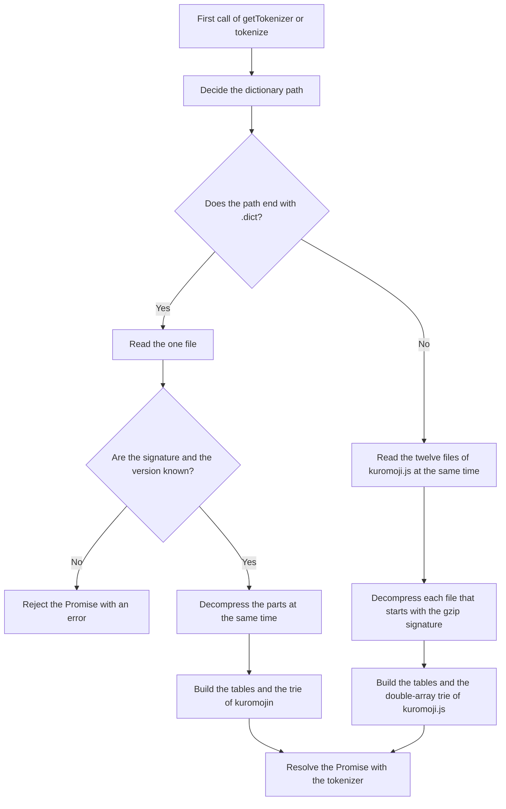

# Dictionary design

[日本語](design.ja.md)

## About this document

This design explains how kuromojin meets the [Dictionary Requirements](requirements.md) of the [kuromojin Product](../../product.md).

### Audience

People and agents who change how kuromojin finds, loads, or stores the dictionary.

### Prerequisites

- The [Dictionary Requirements](requirements.md)
- The [Tokenization Requirements](../tokenization/requirements.md), for the reference result that the dictionary has to keep

### Outside this document

How the tokenizer analyzes a text with the loaded dictionary, and how tokens are reused.

## Implementation approach

kuromojin loads the dictionary by itself.
It decides the dictionary path, reads the dictionary from it, turns it into the tables that the tokenizer reads, and keeps the tokenizer in the module.
The dictionary of the package is one file in a format of kuromojin, whose goal is a small download and a quick load with the same words and costs as the dictionary of kuromoji.js.

### Dictionary path

The path is decided only when a load starts, not on every call.
kuromojin looks at `dicPath` of the `options` of the first call, then at `KUROMOJIN_DIC_PATH`, then at `globalThis.kuromojin.dicPath`.
It reads the global setting through `globalThis`, because a worker and Node.js have no `window`, and `globalThis` is `window` in a page.
When none of them is set, it uses the file `kuromojin.dict` in the `dict` directory of the package.
A small module gives this default path.
In Node.js, the module finds the file from the location of its own code.
For a browser, the `browser` field of `package.json` replaces the module with an ES module that has only `new URL("../dict/kuromojin.dict", import.meta.url)`.
A bundler that supports this expression copies the file into the build and replaces the expression with the URL of the copy.
The rest of the package stays CommonJS, so a rule that requires kuromojin gets the replaced module too.
When the expression has no base URL, as in a bundler without `import.meta`, the module gives no path and the load fails with the error of a missing dictionary path.

### Loading once

The module keeps two values: the loaded dictionary with its tokenizers, and one Promise for the result of the load.
`getTokenizer` returns the tokenizer of the loaded dictionary when it is there.
Otherwise, when the Promise is there, it returns the Promise.
Otherwise it starts the load, keeps its Promise, and returns the Promise.
The load resolves the Promise with the tokenizer or rejects it with the error.

The Promise is never replaced.
So a failed load leaves the rejected Promise in place, and every later call gets it.

### Reading and decompressing

Two functions hide the difference between Node.js and browsers.
The first takes the path or URL of a file and returns its bytes: it reads the file with the file system in Node.js, and requests it with `fetch` in a browser.
The second decompresses gzip data: with the `zlib` module in Node.js, and with `DecompressionStream` in a browser.
kuromojin chooses the pair when a load starts, by whether it runs in Node.js.

### Format of the dictionary

The end of the dictionary path tells the format, so the load reads only the files of one format and never tries the other one.
A path that ends with `.dict` is the file of a dictionary in the format of kuromojin.
Any other path is a directory or a URL with the twelve files of kuromoji.js, which are requested at the same time.
A server can remove the gzip compression of a `.gz` file before the browser sees it, so each of the twelve files is decompressed only when its bytes start with the gzip signature.

Both formats are turned into the same tables, so the tokenizer does not know which one was loaded.
The lookup of the words that start at a position is the only part with two implementations: the trie of kuromojin for its own format, and the double-array trie of kuromoji.js for the other.

### File of the format of kuromojin

The dictionary is one file, so that it is copied, cached, and requested as a whole and its parts can never come from different versions.
The file has three regions in this order.

1. A start of fixed length: a signature that tells that the file is a dictionary of kuromojin, the version of the format, and the length of the table.
2. The table, written as JSON. It names each part of the data and gives its position in the file, its length in the file, and its length after decompression. It also lists the dictionary versions of the file, with the number of entries up to each version and the numbers of the entries that it removes.
3. The parts of the data, each compressed as its own gzip stream.

The start and the table are not compressed, so kuromojin checks the signature and the version before it decompresses anything.
The table comes before the parts, so a reader can decompress each part as soon as its bytes arrive, without waiting for the end of the file.
A file without the signature, or with a version that the code does not know, ends the load with an error.

Each part is its own gzip stream so that the parts are decompressed at the same time.
In Node.js, `zlib` decompresses them on its worker threads, and the length after decompression lets it write each part into one buffer of the right size.
In a browser, each part goes through its own `DecompressionStream`.

### Data of the format of kuromojin

The parts store the same data as the dictionary of kuromoji.js, arranged so that gzip can compress it well and that loading is a few passes over arrays.

- **Words:** A trie of the UTF-16 code units of the words. The nodes are written in breadth-first order, each with its character, the number of its children, and one bit that tells whether a word ends there. The children of a node are next to each other, so no node stores a position.
- **Entries of a word:** For each word, the number of its entries and the numbers of the entries. Each number is written as the difference from the one before, in as few bytes as it needs.
- **Costs and ids:** The left id and the word cost of every entry, each in a column of its own. The right id has a column only when it differs from the left id in some entry.
- **Connection costs:** The matrix of costs, where each cell is written as the difference from the cell on its left.
- **Features:** For every entry, four numbers: its combination of part of speech and conjugation, its base form, its reading, and its pronunciation. Each number points into a list of distinct strings. A marker replaces the number when the base form equals the word as written, or the pronunciation equals the reading.
- **Unknown words:** The classes of characters and the entries of unknown words, as in the dictionary of kuromoji.js.

Numbers of two or four bytes are written as planes: first the lowest byte of every number, then the next byte of every number, and so on.
Neighboring numbers are often close to each other, so the planes of the higher bytes are long runs of the same value, which gzip makes small.

The number of an entry is its position in the dictionary of kuromoji.js.
`word_id` is computed from it, so it has the same value as in the reference result.

When the dictionary is loaded, kuromojin joins the planes, adds up the differences, and builds a hash table from a node of the trie and a character to the child node.
The strings of the features stay in one buffer and are decoded only for the tokens that an analysis returns.

### Building the dictionary of the package

A script of the repository converts the dictionary files of kuromoji.js 0.1.2 into the format of kuromojin.
It converts the built files instead of the sources of mecab-ipadic, so that the entries, their order, and their numbers are the ones of the reference result.
The converted file is kept in the repository in the `dict` directory, together with the notices of mecab-ipadic and kuromoji.js, and it is published with the package.

## Architecture and sequence diagrams

A load is one sequence behind one Promise, with one branch for each format of the dictionary.

A file that cannot be read rejects the Promise in either branch.

## Data model and ER diagrams

The dictionary in memory is four tables.

- **Trie:** From a text position to the words that start there.
- **Entries:** From a word to the left id, the right id, the word cost, and the features of each entry.
- **Connection costs:** From a right id and a left id to a cost.
- **Unknown words:** From a character to its class, and from a class to its entries.

One word has one or more entries, and the entries have no other relation to each other, so a diagram adds nothing.

## APIs and interfaces

- `getTokenizerOption.dicPath?: string` is the dictionary path of a call.
- The environment variable `KUROMOJIN_DIC_PATH` is read in Node.js.
- `globalThis.kuromojin.dicPath` is read in every environment. In a page it is the same as `window.kuromojin.dicPath`.
- The `browser` field of `package.json` replaces `lib/defaultDictionaryPath.js` with `src/defaultDictionaryPath.browser.mjs`, which gives the URL of `dict/kuromojin.dict` with `new URL(path, import.meta.url)`.
- A dictionary path that ends with `.dict` is the file of a dictionary in the format of kuromojin.
- Any other dictionary path is a directory or a URL with the twelve files of kuromoji.js.
- The npm package publishes the `dict` directory with the dictionary of the package, `kuromojin.dict`.

## External service integration

None. The dictionary and the code that loads it are part of the kuromojin package.

## Data handling

The dictionary file is read and never written.
The decompressed dictionary stays in memory until the process ends.

## Authentication and authorization notes

None. kuromojin sends no credentials with the request for the dictionary.

## Security considerations

None beyond the [security considerations of the Requirements](requirements.md#security-considerations).

## Deployment notes

A page or a project that points the dictionary path at a dictionary of kuromoji.js keeps working without a change.
It gets the smaller download only after the path is changed to the `kuromojin.dict` file of the kuromojin package.

The dictionary changes the tokens of a text when its words or costs change, so a change to the base dictionary or to a released dictionary version is released as a major version.
New words are added as a new dictionary version, which is released as a minor version.

## Alternatives considered

### Keep the format of kuromoji.js for the dictionary of the package

The package could publish the twelve files of kuromoji.js as they are.
It was not chosen, because that format stores a double-array trie and fixed-width records, which stay large after gzip, and the dictionary is the largest part of what a writer installs and a browser downloads.

### Look for a file of kuromojin in the dictionary path first

The dictionary path could always be a directory, and the load could ask it for `kuromojin.dict` first and read the twelve files of kuromoji.js only when that file is missing.
It was not chosen, because every load of a dictionary of kuromoji.js would start with a request that fails.
The answer to that request also cannot be trusted to mean "missing": a server that answers every unknown path with the page of an application returns a file that is not a dictionary, and a request that fails for another reason would end in an error about the files of the other format.

### Default to a URL of a CDN in a browser

The default path in a browser could be the URL of the dictionary of the same version on a CDN that serves the files of npm packages.
It would work with every bundler and without a bundler.
It was not chosen, because every page would contact a server that the page did not choose, which the page cannot see without reading the code of kuromojin. The request shows that server who uses the page, a Content Security Policy of the page can block it, and a page without access to that server, for example offline or in a closed network, cannot load the dictionary.
For the same reason, kuromojin does not fall back to a CDN when the copy of a bundler cannot be loaded.

### Add an ES module build with the `exports` field

The whole package could have an ES module build, chosen by the `exports` field of `package.json`.
It was not chosen, because the `exports` field closes the paths of the package that are not listed, such as `kuromojin/dict/kuromojin.dict`, which pages import today, and a rule that requires kuromojin would still get the CommonJS build unless the `browser` condition is listed first. Replacing one module needs neither.

### Read the global setting from `window` only

The global setting could be read from `window.kuromojin.dicPath` only.
It was not chosen, because a worker has no `window`, so a module in a worker could not use the setting.

### Store each part as a file of its own

The parts could be separate files in the dictionary directory, next to a file that tells the version of the format.
It was not chosen, because a dictionary is used only as a whole. Separate files need a request for each part in a browser, and a copy or a cache can end up with parts of different versions.

### Compress the whole file as one gzip stream

The file could be one gzip stream around all the parts.
It was not chosen, because the parts would be decompressed one after another, and the version of the format could be read only after decompression.
A server can also remove the compression of a `.gz` file before the browser sees it, which the loader would have to detect.

### Compress with Brotli

Brotli makes the dictionary smaller than gzip does.
It was not chosen, because `DecompressionStream` does not decompress Brotli in every browser that has it, and a decompressor written in JavaScript would have to be added for those browsers.
The [format list of `DecompressionStream`](https://developer.mozilla.org/en-US/docs/Web/API/DecompressionStream/DecompressionStream) shows which browsers support each format.

### Build the dictionary from the sources of mecab-ipadic

The dictionary could be built from the CSV files of mecab-ipadic.
It was not chosen, because the order and the numbers of the entries decide `word_id` and the result for splits with equal costs, and the built files of kuromoji.js are the only place that has them as the reference result needs.

### Other decisions

There is no record of alternatives for the order of the sources of the dictionary path, or for keeping a failed load.
The reasons for them are unknown.

## Open questions

None.
