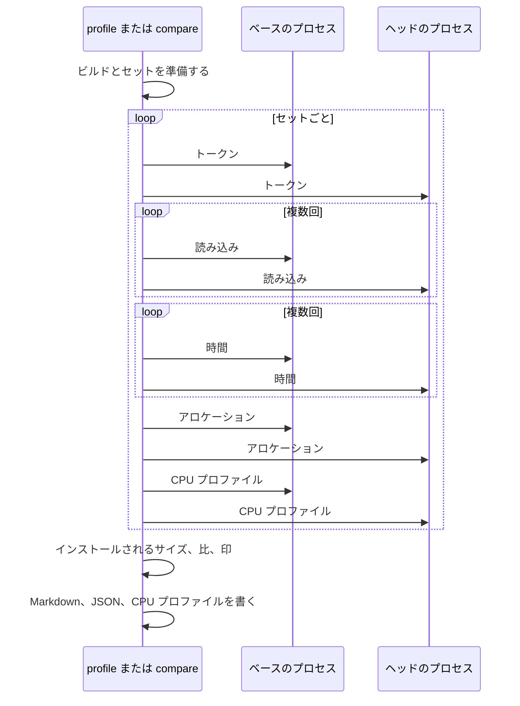

# パフォーマンスのプロファイルの設計

[English](design.md)

## この文書について

この設計は、リポジトリのスクリプトと CI のワークフローが、[kuromojin の Product](../../product.ja.md) の [パフォーマンスのプロファイルの Requirements](requirements.ja.md) をどう満たすかを説明します。

### 読者

プロファイルのスクリプト、テキストのセット、CI のワークフローを変更する人とエージェント。

### 前提知識

- [パフォーマンスのプロファイルの Requirements](requirements.ja.md)
- [トークン化の Requirements](../tokenization/requirements.ja.md)。`getTokenizer`、`tokenize`、トークンの再利用について

### この文書の範囲外

kuromojin が辞書を読み込み、テキストを解析する方法。

## 実装の方針

プロファイルは、`benchmark/` より下のスクリプトである。公開するパッケージには含まれない。
スクリプトは、Node.js の組み込みモジュールだけを使う JavaScript である。そのため、ビルドの手順なしで動き、スクリプトを知らないコミットも計測する。
2 つのコマンドがスクリプトを始める。`pnpm run profile` は作業ツリーを計測し、`pnpm run compare` はベースと作業ツリーを計測する。どちらも、1 つまたは 2 つのビルドで同じコードを実行する。

### ビルドを外から計測する

ビルドは、ビルド済みのパッケージを持つディレクトリである。作業ツリー、またはベースのチェックアウトである。
計測は、呼び出し側と同じようにそのディレクトリのパッケージを読み込み、`getTokenizer`、`tokenize`、トークナイザーの 2 つの関数だけを使う。
解析は、どのテキストももう一度解析する `getTokenizer({ noCacheTokenize: true })` のトークナイザーで計測する。トークンを再利用しないトークナイザーのビルドは、このオプションを無視する。
ヘッドのスクリプトが両方のビルドを計測するので、ベースはスクリプトを持たなくてよい。
パッケージはプロファイルのためのコードを持たない。そのため、プロファイルは、呼び出し側の実行に何のコストもかけない。

### 1 つの計測に 1 つのプロセス

それぞれの計測は、Node.js の新しいプロセスで実行し、結果を JSON で出力する。
計測は、ほかの計測を乱さない。読み込みは何も読み込んでいないプロセスで計測し、時間はプロファイラーなしで計測する。アロケーションのサンプリングと CPU プロファイルは、それぞれのプロセスで実行する。
1 つのセットの計測は、次のとおりである。

- **トークン：** プロセスは、すべての行とすべてのファイルを解析し、それぞれのトークンのダイジェストを返す。ダイジェストは、すべてのトークンのフィールドを決まった順序で並べたものから作る。そのため、2 つのビルドは、同じトークンに対してだけ同じダイジェストを返す。
- **読み込み：** プロセスは、モジュールを読み込む前から `getTokenizer` の Promise が解決するまでの時間と、ガベージコレクションの後に使っているメモリを取る。複数のプロセスを実行し、中央値を採用する。読み込みは、1 つのプロセスの中で繰り返せないからである。
- **時間：** プロセスは、すべての行を解析する回を繰り返し、次にすべてのファイルを解析する回を繰り返して、それぞれの回の時間を返す。回は、少なくとも 3 回、合計が 0.5 秒になるまで繰り返す。10 秒を過ぎると、新しい回を始めない。次に、前に渡した 100 個のテキストに対して `tokenize` を何度も呼び出し、1 回の呼び出しの時間を返す。100 個は、覚えているトークンのどの上限よりも少ない。最後に、すべての行に対して `tokenize` を呼び出し、使っているメモリを返す。複数のプロセスを実行し、そのすべての中でもっとも速い回を採用する。
- **アロケーション：** プロセスは、すべての行を解析する回のガベージコレクションを数える。次に、同じ回数だけ解析して、割り当てたバイト数をサンプリングする。ガベージコレクションがすでに解放したオブジェクトも数える。サンプリングはガベージコレクションを変えるので、ガベージコレクションはサンプリングなしで数える。数値は 1 回あたりである。小さいセットは、サンプルが足りるように回数を増やす。Node.js 18 は解放したオブジェクトを数えないので、アロケーションの計測には Node.js 20 以降が必要である。
- **CPU プロファイル：** 辞書を読み込み、行とファイルを決まった回数だけ解析するプロセスの CPU プロファイルを、Node.js が書く。

使っているメモリは、ガベージコレクションを強制した後の、ヒープとヒープの外のバッファーである。

### 2 つのビルドを交互に

読み込みと時間では、比較は、ベースのプロセスを 1 つ、次にヘッドのプロセスを 1 つ始め、これを繰り返す。
この 1 巡が 1 分を超えたときは、それを最後の 1 巡にする。そのため、解析が遅いビルドは、少ないプロセスで計測する。
CPU プロファイルの回数は、計測した時間から決める。遅いほうのビルドが約 1 秒で実行する回数である。両方のビルドがこの回数を実行するので、2 つのプロファイルは同じ仕事のものになる。

### トークンの違い

比較は、2 つのビルドのダイジェストを、行ごと、ファイルごとに比べる。
ダイジェストが異なる最初の 10 個のテキストについて、両方のビルドにトークンを求め、同じでない最初のトークンを見つける。
Markdown は、そのトークンの表層形と、異なるフィールドを表示する。

### ビルド

作業ツリーは、計測の前に `pnpm run build` でビルドする。ビルドしないオプションを指定したときを除く。
ベースは、キャッシュのディレクトリに置く、そのコミットの Git の worktree である。依存パッケージは、ロックファイルから、パッケージのスクリプトを実行せずにインストールする。ビルドは `run build` で行う。どちらも、ロックファイルのパッケージマネージャーを使う。`pnpm-lock.yaml` には pnpm を、pnpm に移る前のコミットの `yarn.lock` には Yarn 1 を使う。
worktree の中のファイルが、ビルドが終わったことを示す。そのため、中断されたビルドはやり直し、終わったビルドは再び使う。

### テキストのセット

`benchmark/sets.json` がセットを定義する。作業ツリーのディレクトリ、またはリポジトリとコミットとディレクトリを持ち、ドキュメントの名前の終わりを持つ。
リポジトリのセットは、そのコミットの浅くて部分的な fetch で、キャッシュのディレクトリに取得する。
ドキュメントは、パスの順序で読む。空白でない文字を持つそれぞれの行がセットの行であり、それぞれのドキュメントがファイルである。
テキストは 1 つの JSON ファイルに書き、すべてのビルドのすべての計測がそのファイルを読む。

### インストールされるサイズ

パッケージのファイルは、npm が公開するファイルである。`npm pack --dry-run` から得る。これは、パッケージのスクリプトを実行せずにファイルを一覧にする。
依存パッケージは、`package.json` の `dependencies` から、Node.js がパッケージを解決するのと同じように `node_modules` をたどって見つける。依存パッケージのサイズは、`node_modules` にあるそのファイルのサイズである。

### 結果と印

すべての計測の数値を、1 つの結果に集める。比較では、それぞれの項目が、ベースに対するヘッドの比と、印を持つ。
印を付ける範囲と、印を付けるもっとも小さい違いは、`benchmark/lib/report.js` の先頭の定数である。
Markdown と JSON は結果から作り、すべての計測が終わったときにだけ書く。そのため、失敗しても途中までの結果は残らない。

### 失敗

知らないセットや存在しないベースのように、コマンドを実行する人が直せるエラーは、スタックトレースなしの 1 つのメッセージとして出力し、コマンドは失敗の状態で終わる。
失敗した計測は、そのプロセスのエラーを、ビルド、セット、計測の名前とともに出力する。

## アーキテクチャとシーケンス図

1 つのビルドのプロファイルは、ベースのない同じシーケンスである。

## データモデルと ER 図

結果は、1 つの JSON のオブジェクトである。木の形なので、図は必要ない。

- **マシン：** Node.js のバージョン、プラットフォーム、CPU の数
- **ビルド：** ベースとヘッドについて、コミット、ベースの ref、作業ツリーにコミットしていない変更があるかどうか
- **セット：** セットごとに、名前、取得元、ファイルと行と文字の数、項目、ガベージコレクションの回数、トークンの違い、CPU プロファイルの回数、ビルドごとのパッケージ別と関数別の CPU 時間、CPU プロファイルのパス
- **項目：** id、タイトル、単位、それぞれのビルドの数値。比較では、比、印、`slower` のような印の言葉も持つ
- **サイズ：** インストールされるサイズの項目と、それぞれのビルドの依存パッケージとそのサイズ

## API とインターフェース

### コマンド

`pnpm run profile` と `pnpm run compare` は、次のオプションを受け取る。`--help` がこれらを出力する。

| オプション | 意味 | 既定 |
| --- | --- | --- |
| `--base <ref>` | `compare` だけ：作業ツリーと比較するコミット | `origin/master`。存在しないときは `master` |
| `--set <names>` | カンマで区切ったセット | すべてのセット |
| `--out-dir <dir>` | 結果を書く場所 | 作業ツリーの `profile-result` |
| `--cache-dir <dir>` | ダウンロードしたセットと、ベースのビルドを残す場所 | `~/.cache/kuromojin-profile` |
| `--no-build` | 作業ツリーをビルドしない | ビルドする |

Markdown は標準出力に、進み具合は標準エラー出力に出す。

### 出力のディレクトリ

- `profile.md`：Markdown
- `profile.json`：結果
- `cpuprofiles/<set>-<build>.cpuprofile`：CPU プロファイル

### 計測のプロセス

`benchmark/worker.js` は、計測の名前、ビルドのディレクトリ、セットのテキストのファイルを受け取り、JSON を出力する。
ビルドが失敗したときは、失敗の状態で終わり、標準エラー出力にエラーを出す。

## 外部サービスとの連携

リポジトリのセットは、認証なしで、Git を使って HTTPS で GitHub から取得する。
CI のワークフローは、GitHub Actions で動く。

## データの扱い

キャッシュのディレクトリは、ダウンロードしたセットと、ベースのビルドを残す。これらを削除するものはない。空きを取り戻すには、人がディレクトリを削除する。
出力のディレクトリはコミットしない。`profile-result` は Git が無視する。

## 認証と認可の注意

なし。スクリプトは、公開リポジトリと手元のリポジトリを読む。

## セキュリティの考慮事項

ワークフローは `pull_request` イベントで動く。そのため、フォークからのプルリクエストは、読み取りだけができるトークンを受け取り、シークレットを受け取らない。
ワークフローは、コンテンツの読み取りの権限だけを宣言し、チェックアウトは認証情報を残さない。
アクションは、コミットに固定する。
CI でのヘッドのインストールと、ベースのインストールは、パッケージのスクリプトを実行しない。

## デプロイの注意

なし。

## 検討した代替案

### パッケージの中のプロファイラー

textlint と secretlint は、自分のコードの中のプロファイラーで各段階を記録し、コマンドのフラグでそれを出力する。
kuromojin にはコマンドがない。そのため、プロファイラーはパッケージの API になり、`tokenize` の呼び出しのたびに、プロファイラーが有効かどうかを調べることになる。
プロファイラーより前のコミットを計測することもできない。
採用しない。CPU プロファイルは、パッケージの中のコードなしで、パッケージの中の関数の時間を示す。

### すべての計測に 1 つのプロセス

速いが、計測が互いを乱す。プロファイラーは時間を遅くし、ある計測がメモリに持ち続けるものは、次の計測のガベージコレクションを変える。
採用しない。

### ルールを付けて textlint を実行する

書き手が見るものを計測するが、時間のほとんどをルールが使い、ルールのバージョンが結果を変える。
採用しない。プロファイルは、kuromojin だけを計測する。

### 印で CI を失敗させる

遅い変更をマージの前に止められる。しかし、CI のマシンは共有されている。意図して遅くする変更には、チェックを避ける方法も必要になる。
採用しない。ジョブは結果を示し、人が決める。

### より大きなセット

数千のドキュメントのセットは、それ以上のことを示さない。解析の時間は、テキストに比例して増えるからである。
採用しない。

## 未解決事項

なし。印を付ける範囲は Requirements にある。
