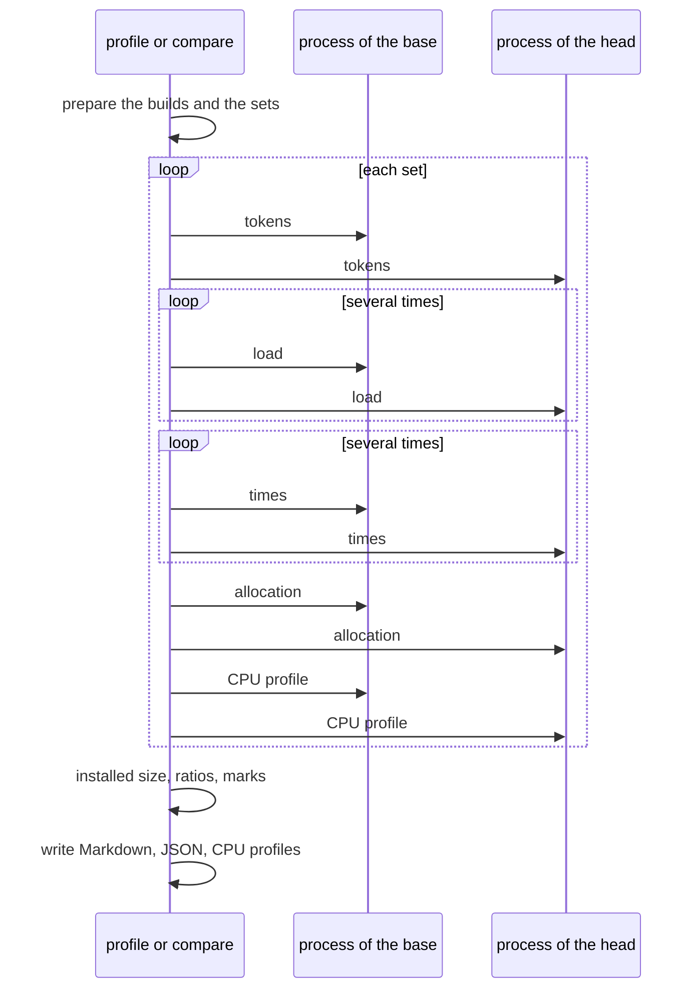

# Performance profile design

[日本語](design.ja.md)

## About this document

This design explains how the scripts of the repository and the CI workflow meet the [Performance profile Requirements](requirements.md) of the [kuromojin Product](../../product.md).

### Audience

People and agents who change the scripts of the profile, the sets of texts, or the CI workflow.

### Prerequisites

- The [Performance profile Requirements](requirements.md)
- The [Tokenization Requirements](../tokenization/requirements.md), for `getTokenizer`, `tokenize`, and the reuse of tokens

### Outside this document

How kuromojin loads a dictionary and analyzes a text.

## Implementation approach

The profile is a set of scripts under `benchmark/`. They are not part of the published package.
The scripts are JavaScript that uses only the built-in modules of Node.js, so they run without a build step and measure a commit that knows nothing about them.
Two commands start them: `yarn run profile` measures the working tree, and `yarn run compare` measures a base and the working tree. Both run the same code with one or two builds.

### A build is measured from outside

A build is a directory with a built package: the working tree, or a checkout of the base.
A measurement loads the package of that directory as a caller does, and uses only `getTokenizer`, `tokenize`, and the two functions of the tokenizer.
The analysis is measured with the tokenizer of `getTokenizer({ noCacheTokenize: true })`, which analyzes every text again. A build whose tokenizer does not reuse tokens ignores the option.
The scripts of the head measure both builds, so the base does not need to have the scripts.
The package gets no code for the profile, so the profile costs nothing in the run of a caller.

### One process for one measurement

Each measurement runs in a new process of Node.js, and prints its result as JSON.
A measurement does not disturb another one: the load is measured in a process that has loaded nothing, the times are measured without a profiler, and the sampling of the allocation and the CPU profile run in processes of their own.
The measurements of one set are:

- **Tokens:** The process analyzes every line and every file, and returns a digest of the tokens of each. A digest is made from the fields of every token in a fixed order, so two builds give the same digest only for the same tokens.
- **Load:** The process takes the time from before it loads the module until the Promise of `getTokenizer` resolves, and the used memory after garbage collections. Several processes run, and the median counts, because a load cannot be repeated in one process.
- **Times:** The process repeats a pass over all lines, then a pass over all files, and returns the time of each pass. A pass is repeated at least three times and until the passes take half a second, and no pass starts after ten seconds. Then it calls `tokenize` many times for a hundred texts that it has passed before, which is less than any limit of the remembered tokens, and returns the time of a call. At the end it calls `tokenize` for every line and returns the used memory. Several processes run, and the fastest pass of all of them counts.
- **Allocation:** The process counts the garbage collections of passes over all lines, and then samples the allocated bytes of the same number of passes, with the objects that a collection has already freed. The collections are counted without the sampling, because the sampling changes them. The numbers are for one pass. A small set gets more passes, so that it has enough samples. Node.js 18 does not count the freed objects, so the allocation needs Node.js 20 or later.
- **CPU profile:** Node.js writes a CPU profile of a process that loads the dictionary and runs a fixed number of passes over the lines and the files.

The used memory is the heap and the buffers outside the heap, after forced garbage collections.

### Two builds in turns

For the load and the times, the comparison starts one process of the base, then one of the head, and repeats this.
When one such round takes more than a minute, it is the last one, so a build with a slow analysis is measured in fewer processes.
The number of passes of a CPU profile comes from the measured times: as many passes as the slower build runs in about one second. Both builds run this number, so their profiles are of the same work.

### Differences of the tokens

The comparison compares the digests of the two builds line by line and file by file.
For the first ten texts whose digests differ, it asks both builds for the tokens, and finds the first token that is not the same.
The Markdown shows the surface form of that token and the fields that differ.

### Builds

The working tree is built with `yarn run build` before the measurements, unless the option not to build is given.
The base is a Git worktree of its commit in the cache directory. Its dependencies are installed from its lock file without running the scripts of packages, and it is built with `yarn run build`.
A file in the worktree marks a finished build, so a build that was interrupted is made again, and a finished one is used again.

### Sets of texts

`benchmark/sets.json` defines the sets: a directory of the working tree, or a repository with a commit and a directory, and the ending of the names of the documents.
A set of a repository is fetched into the cache directory with a shallow, sparse fetch of that commit.
The documents are read in the order of their paths. Each line that has a character other than white space is a line of the set, and each document is a file.
The texts are written to one JSON file, and every measurement of every build reads that file.

### Installed size

The files of the package are the ones that npm would publish, from `npm pack --dry-run`, which lists them without running the scripts of the package.
The dependencies are found from `dependencies` of `package.json`, following them through `node_modules` as Node.js resolves packages. The size of a dependency is the size of its files in `node_modules`.

### Result and marks

The numbers of all measurements are collected into one result. For a comparison, each item gets the ratio of the head to the base and a mark.
The ranges of the marks and the smallest difference that is marked are constants at the top of `benchmark/lib/report.js`.
The Markdown and the JSON are made from the result, and they are written only when every measurement has ended. So a failure leaves no partial result.

### Failures

An error that the person who runs the command can fix, such as an unknown set or a base that does not exist, is printed as one message without a stack trace, and the command ends with a failure status.
A measurement that fails prints the error of its process, with the build, the set, and the measurement.

## Architecture and sequence diagrams

The profile of one build is the same sequence without the base.

## Data model and ER diagrams

The result is one JSON object. No diagram is needed, because it is a tree.

- **Machine:** the version of Node.js, the platform, and the number of CPUs
- **Builds:** for the base and the head, the commit, the ref of the base, and whether the working tree has changes that are not committed
- **Sets:** for each set, its name, its source, the numbers of files, lines, and characters, the items, the numbers of garbage collections, the differences of the tokens, the number of passes of the CPU profiles, the CPU time by package and by function for each build, and the paths of the CPU profiles
- **Item:** an id, a title, a unit, the number of each build, and for a comparison the ratio, the mark, and the word of the mark, such as `slower`
- **Size:** the items of the installed size, and the dependencies of each build with their sizes

## APIs and interfaces

### Commands

`yarn run profile` and `yarn run compare` take these options. `--help` prints them.

| Option | Meaning | Default |
| --- | --- | --- |
| `--base <ref>` | Only `compare`: the commit to compare the working tree with | `origin/master`, or `master` when it does not exist |
| `--set <names>` | The sets, separated by commas | Every set |
| `--out-dir <dir>` | Where the result is written | `profile-result` in the working tree |
| `--cache-dir <dir>` | Where a downloaded set and the build of a base are kept | `~/.cache/kuromojin-profile` |
| `--no-build` | Do not build the working tree | Build it |

The Markdown goes to the standard output, and the progress goes to the standard error.

### Output directory

- `profile.md`: the Markdown
- `profile.json`: the result
- `cpuprofiles/<set>-<build>.cpuprofile`: the CPU profiles

### Measurement process

`benchmark/worker.js` takes the name of a measurement, the directory of a build, and the file of the texts of a set, and prints JSON.
It ends with a failure status and the error on the standard error when the build fails.

## External service integration

A set of a repository is fetched from GitHub over HTTPS with Git, without authentication.
The CI workflow runs on GitHub Actions.

## Data handling

The cache directory keeps the downloaded sets and the builds of bases. Nothing removes them; a person removes the directory to get the space back.
The output directory is not committed: `profile-result` is ignored by Git.

## Authentication and authorization notes

None. The scripts read public repositories and the local repository.

## Security considerations

The workflow runs on the `pull_request` event, so a pull request from a fork gets a token that can only read and no secret.
The workflow declares the read permission for the contents only, and the checkout does not keep the credentials.
The actions are pinned to commits.
The install of the head in CI and the install of the base do not run the scripts of packages.

## Deployment notes

None.

## Alternatives considered

### A profiler inside the package

textlint and secretlint record their phases with a profiler in their own code, and a flag of their commands prints it.
kuromojin has no command, so a profiler would be an API of the package, and every `tokenize` call would check whether it is on.
It could also not measure a commit from before the profiler.
Not chosen. The CPU profile shows the time of the functions inside the package without code in the package.

### One process for all measurements

It is faster, but the measurements disturb each other: a profiler slows the times, and what one measurement keeps in memory changes the garbage collections of the next.
Not chosen.

### Running textlint with rules

It measures what a writer sees, but the rules take most of the time and their versions change the result.
Not chosen. The profile measures kuromojin alone.

### Failing CI on a mark

It would stop a slow change before the merge, but the machines of CI are shared, and a change that is slower on purpose would need a way around the check.
Not chosen. The job shows the result, and a person decides.

### A larger set

A set of thousands of documents would show nothing more: the time of the analysis grows in proportion to the text.
Not chosen.

## Open questions

None. The ranges of the marks are in the Requirements.
