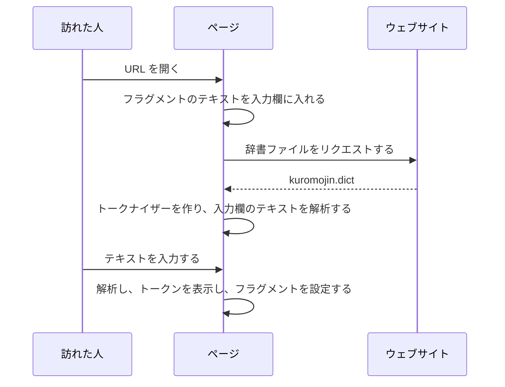

# オンラインのプレイグラウンドの設計

[English](design.md)

## この文書について

この設計は、kuromojin のウェブサイトが [kuromojin の Product](../../product.ja.md) の [オンラインのプレイグラウンドの Requirements](requirements.ja.md) をどう満たすかを説明します。

### 読者

プレイグラウンドのページ、またはウェブサイトのビルドと配信の方法を変更する人とエージェント。

### 前提知識

- [オンラインのプレイグラウンドの Requirements](requirements.ja.md)
- [辞書の Requirements](../dictionary/requirements.ja.md)。辞書のパスと、辞書の 2 つの形式

### この文書の範囲外

kuromojin が辞書を読み込み、テキストを解析する方法。

## 実装の方針

ウェブサイトは、1 ページの静的なサイトです。
バンドラーが、リポジトリの kuromojin のソースからビルドします。そのため、ページはいつも、ビルドしたコミットの kuromojin を実行します。
ページは `getTokenizer` を一度呼び、テキストが変わるたびにそのトークナイザーで解析します。

### ページの辞書

ページは、リポジトリの辞書ファイル `kuromojin.dict` を URL としてインポートします。ファイルの URL を受け取るための、バンドラーのインポートを使います。
バンドラーは、ファイルを出力にコピーし、同じサイトの上のその URL をページに渡します。
コピーの名前は、内容のハッシュを持ち、末尾の `.dict` を保ちます。末尾は kuromojin に辞書の形式を伝えます。ハッシュがあるので、ブラウザは辞書が変わるまでファイルを保持できます。
ページは、その URL を `dicPath` として `getTokenizer` に渡します。

kuromojin は、Node.js で動くときだけ Node.js のモジュールを使い、バンドラーがたどらない方法でそれを取得します。
そのため、ページは、それらのモジュールの代わりを用意せずにビルドできます。

### 解析と出力

ページは、`getTokenizer` の Promise が解決したときに、トークナイザーを保持します。
1 つの関数が、テキストの入力欄のテキストを読み、トークナイザーの `tokenizeForSentence` を呼び、トークンを JSON として出力欄に書きます。
この関数は、入力欄の input イベントのたびに実行し、トークナイザーを得たときにも一度実行します。そのため、それより前に入力したテキストや URL から取ったテキストも解析します。

出力欄は読み取り専用のテキスト欄で、ページはそのテキストを設定し、HTML は設定しません。

欄の上の 1 行が状態を表示します。読み込み中、準備完了、または `getTokenizer` の Promise が拒否されたときのエラーのメッセージです。

### URL のテキスト

ページは、input イベントのたびに、URL のフラグメントを、パーセントエンコードしたテキストにします。
ページは、開始するときにフラグメントをデコードし、そのテキストを入力欄に入れます。
デコードが失敗したときは、入力欄を空のままにします。

### ほかのページのための辞書のファイル

ビルドは、出力の `dict` ディレクトリにファイルをコピーします。そこでは、ビルドが変わっても URL が変わりません。

- リポジトリの辞書ファイル `kuromojin.dict`
- npm パッケージ kuromoji 0.1.2 の `dict` ディレクトリの 12 個のファイル。リポジトリは、このパッケージを開発用の依存として持つ

ホスティングサービスの設定が、`/dict/` より下のすべてのレスポンスに、ヘッダー `Access-Control-Allow-Origin: *` を付けます。

パッケージの辞書は、出力に 2 つあります。ページのためのハッシュ付きの名前のものと、ほかのページのための固定の名前のものです。

## アーキテクチャとシーケンス図

## データモデルと ER 図

なし。ページは、テキストとトークンを入力欄と出力欄にだけ持ちます。

## API とインターフェース

- **ページ：** `https://kuromojin.netlify.app/`。URL のフラグメントは、パーセントエンコードしたテキストである。
- **パッケージの辞書：** `https://kuromojin.netlify.app/dict/kuromojin.dict`。
- **kuromoji.js の辞書：** 12 個のファイルを持つ `https://kuromojin.netlify.app/dict/`。

## 外部サービスとの連携

- **Netlify：** リポジトリのビルドコマンドを実行し、出力のディレクトリを配信する。リポジトリにある Netlify の設定ファイルが、ビルドコマンド、出力のディレクトリ、`/dict/` のヘッダーを持つ。

## データの扱い

テキストは、ページの中と URL のフラグメントにとどまります。
ウェブサイトは、保存する場所もサーバーのコードも持ちません。

## 認証と認可の注意

なし。ウェブサイトにあるものはすべて公開されています。

## セキュリティの考慮事項

フラグメントのテキストは入力欄の値に、トークンは出力欄のテキストに書きます。
どちらも HTML として解釈されません。そのため、ほかの人が作った URL が、ページに要素やスクリプトを加えることはできません。

## デプロイの注意

ウェブサイトは、リポジトリのデフォルトブランチからビルドします。
そのため、プレイグラウンドと `/dict/` の下の辞書は、npm の最新のリリースより新しいことがあります。

kuromoji.js の 12 個のファイルは、ウェブサイトに残します。URL でそれを読み込むページが、なくなると動かなくなるためです。

## 検討した代替案

### npm の CDN から辞書を読み込む

npm パッケージのファイルを配信する CDN の上の、辞書の URL をページが指定する方法です。
採用しませんでした。ページがほかのサービスに依存し、ビルドしたコミットの辞書ではなく、リリースの辞書を表示するためです。

### 固定の名前のファイルを読み込む

ウェブサイトがほかのページに配信するファイル `/dict/kuromojin.dict` を、ページが読み込む方法です。辞書は出力に 1 つだけになります。
採用しませんでした。このページはバンドラーでビルドするページの例であり、そのようなページは URL をバンドラーから受け取るためです。ハッシュ付きの名前には、ブラウザがファイルを安全に保持できる利点もあります。

### パッケージの辞書だけを配信する

ウェブサイトが、kuromoji.js の 12 個のファイルの配信をやめる方法です。
採用しませんでした。そのディレクトリの URL は公開されていて、それを使うページが失敗するためです。

## 未解決事項

なし。
