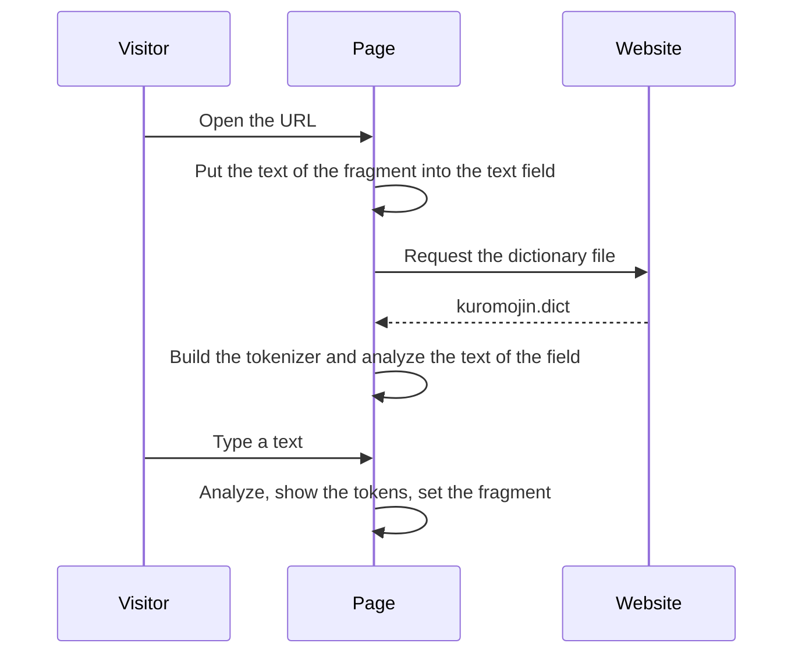

# Online playground design

[日本語](design.ja.md)

## About this document

This design explains how the website of kuromojin meets the [Online playground Requirements](requirements.md) of the [kuromojin Product](../../product.md).

### Audience

People and agents who change the page of the playground, or how the website is built and served.

### Prerequisites

- The [Online playground Requirements](requirements.md)
- The [Dictionary Requirements](../dictionary/requirements.md), for the dictionary path and the two formats of a dictionary

### Outside this document

How kuromojin loads a dictionary and analyzes a text.

## Implementation approach

The website is a static site of one page.
A bundler builds it from the source of kuromojin in the repository, so the page always runs the kuromojin of the commit that it is built from.
The page calls `getTokenizer` once and analyzes the text with the tokenizer on every change.

### Dictionary of the page

The page imports the dictionary file `kuromojin.dict` of the repository as a URL, with the import of the bundler for the URL of a file.
The bundler copies the file into the output and gives the page its URL on the same site.
The name of the copy has a hash of the content and keeps the ending `.dict`. The ending tells kuromojin the format of the dictionary, and the hash lets a browser keep the file until the dictionary changes.
The page passes the URL as `dicPath` to `getTokenizer`.

kuromojin uses the modules of Node.js only when it runs in Node.js, and its `package.json` tells a bundler for browsers to leave them out.
So the page is built without replacements for those modules.

### Analysis and output

The page keeps the tokenizer when the Promise of `getTokenizer` resolves.
A function reads the text of the text field, calls `tokenizeForSentence` of the tokenizer, and writes the tokens as JSON into the output field.
It runs on every input event of the text field, and once when the tokenizer is there, so a text that was typed or taken from the URL before is analyzed too.

The output field is a read-only text field, and the page sets its text and never its HTML.

A line above the fields shows the state: loading, ready, or the message of the error when the Promise of `getTokenizer` is rejected.

### Text in the URL

On every input event, the page sets the fragment of its URL to the text in percent-encoding.
When the page starts, it decodes the fragment and puts the text into the text field.
When the decoding fails, it leaves the field empty.

### Dictionary files for other pages

The build copies files into the directory `dict` of the output, where their URLs do not change between builds.

- The dictionary file `kuromojin.dict` of the repository
- The twelve files of the `dict` directory of the npm package kuromoji 0.1.2, which the repository has as a development dependency

The configuration of the hosting service adds the header `Access-Control-Allow-Origin: *` to every response under `/dict/`.

The dictionary of the package is in the output twice: once under the name with the hash for the page, and once under the fixed name for other pages.

## Architecture and sequence diagrams

## Data model and ER diagrams

None. The page keeps the text and the tokens only in its fields.

## APIs and interfaces

- **Page:** `https://kuromojin.netlify.app/`. The fragment of the URL is the text in percent-encoding.
- **Dictionary of the package:** `https://kuromojin.netlify.app/dict/kuromojin.dict`.
- **Dictionary of kuromoji.js:** `https://kuromojin.netlify.app/dict/` with the twelve files.

## External service integration

- **Netlify:** It runs the build command of the repository and serves the output directory. Its configuration file in the repository has the build command, the output directory, and the header for `/dict/`.

## Data handling

The text stays in the page and in the fragment of the URL.
The website has no storage and no server code.

## Authentication and authorization notes

None. Everything on the website is public.

## Security considerations

The text of the fragment is written into the value of a text field, and the tokens into the text of the output field.
Neither is parsed as HTML, so a URL that another person made cannot add elements or scripts to the page.

## Deployment notes

The website is built from the default branch of the repository.
So the playground and the dictionary under `/dict/` can be newer than the latest release on npm.

The twelve files of kuromoji.js stay on the website, because pages that load them by URL would break without them.

## Alternatives considered

### Load the dictionary from a CDN of npm

The page could name the URL of the dictionary on a CDN that serves the files of npm packages.
It was not chosen, because the page would depend on another service, and it would show the dictionary of a release instead of the dictionary of the commit that it is built from.

### Load the file with the fixed name

The page could load `/dict/kuromojin.dict`, the file that the website serves to other pages, and the dictionary would be in the output once.
It was not chosen, because the page is the example for a page that is built with a bundler, and such a page gets the URL from the bundler. The name with the hash also lets a browser keep the file safely.

### Serve only the dictionary of the package

The website could stop serving the twelve files of kuromoji.js.
It was not chosen, because the URL of that directory is public, and pages that use it would fail.

## Open questions

None.
